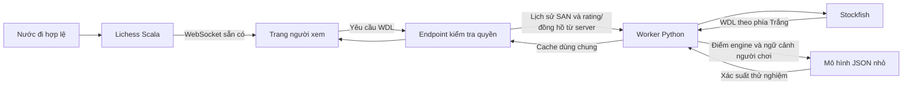

# Lichess WDL Lab

Fork Lichess tự host, hiển thị một thanh **Trắng thắng / Đen thắng** ngay trên bàn của cả hai người chơi và người xem ván cờ tiêu chuẩn, gồm chơi với máy và người–người. Hai tỷ lệ cộng lại bằng **100%**, tính với điều kiện ván có bên thắng: `Trắng = W / (W + B)`, `Đen = B / (W + B)`. Phần hòa không xuất hiện trên thanh; dữ liệu WDL gốc vẫn được giữ bên trong. Thanh ưu tiên mô hình người chơi có xét thế cờ, rating và đồng hồ; khi thiếu dữ liệu hoặc ngoài phạm vi, dùng engine. Nhãn bên dưới cho biết nguồn và “không tính hòa”. Ván đã hòa hiện kết quả chính thức; khi `W + B = 0`, giao diện không tự gán tỷ lệ 50/50.

Tiến độ và bằng chứng nằm trong [mốc engine](openspec/changes/live-win-probability/tasks.md) và [mốc mô hình người chơi](openspec/changes/human-win-probability/tasks.md). Phạm vi, kết quả và giới hạn mô hình được ghi trong [model card](reports/human-v1/model-card.md).

**Báo cáo nghiệm thu cuối bằng tiếng Việt:** [bao-cao-nghiem-thu.md](reports/acceptance/bao-cao-nghiem-thu.md), kèm log, JSON và ảnh được lưu trong `reports/acceptance/evidence/`.

**Cập nhật giao diện theo phản hồi:** [tỷ lệ Trắng/Đen khi ván có bên thắng](reports/acceptance/two-way-probability/README.md). [Bản ba tỷ lệ trước đây](reports/acceptance/ui-don-gian.md) được giữ làm lịch sử.

**Xem tỷ lệ trên bàn chơi với máy hoặc người:** [phạm vi, kiểm thử và cách chạy](reports/acceptance/player-win-probability/README.md). Máy chủ kiểm tra cờ bật tính năng và biến thể của ván; cả hai bên đều dùng dữ liệu thế cờ từ máy chủ.

**Chơi cờ bằng giọng nói tiếng Việt (thử nghiệm, Vosk + PhoWhisper, không LLM):**
[Chế độ hiện tại: nước hợp lệ đi ngay, nước sai/chưa rõ có thông báo](reports/voice-v1/direct-moves/README.md).
Giữ Shift nói câu lệnh rồi thả phím; không cần nói “Xác nhận”. Kiểm thử audio
hiện tại dùng `node scripts/voice-recorded-e2e.mjs --direct --files --bot`.
Các báo cáo xác nhận hai bước bên dưới được giữ làm lịch sử.
[cách bật, lệnh nói, kiểm thử và giới hạn](reports/voice-v1/README.md).
Đã nối PhoWhisper và VAD vào trang chơi: Vosk thử trước; nếu parser chưa xử lý
được câu nói, audio được nhận dạng lại bằng PhoWhisper trên máy local.
Dùng `scripts/voice.ps1 live` trên stack đã bootstrap/start để chuẩn bị model,
khởi động dịch vụ và build UI. Xem [hướng dẫn test trực tiếp](reports/voice-v1/live/README.md).
Nút **Thu mẫu** mở [trang thu nguyên câu trên local](http://localhost:8080/voice-asr/record);
bản thu chỉ lưu khi bấm lưu, để kiểm thử nhận âm và câu lệnh đi quân.
[Hướng dẫn thu và chạy acceptance](reports/voice-v1/recorder/README.md).
`scripts/voice.ps1 matrix` chạy bộ kiểm thử mở rộng; báo cáo giữ nguyên các ca
nhận dạng còn lỗi, xem kết quả và giới hạn trong tài liệu trên.
[So sánh PhoWhisper-small với Vosk](reports/voice-v1/asr-comparison/README.md)
ghi độ đúng lệnh, WER và độ trễ CPU trên cùng PCM trước khi tích hợp live.
[Đợt tinh chỉnh tiếp theo](reports/voice-v1/asr-tuning/README.md) thử INT8,
prompt từ vựng cố định và Vosk → PhoWhisper khi parser chưa hiểu: 90/95 ca
so với 76/95 của Vosk ở lượt đầu; median/p95 93/1.399 ms trong pipeline local.
Đây là số đo benchmark native, không phải độ trễ microphone/web hiện tại.

## Chạy trên máy này

Cần Docker Desktop chạy Linux containers, Git và PowerShell. Máy kiểm thử cấp khoảng 14 GiB RAM cho Docker; lần build đầu tải nhiều dependency của Lichess. `uv` cần cho ASR local và kiểm thử Python; Node cần cho kiểm thử trình duyệt ở máy host.

```powershell
# Lần đầu: lấy đúng source, áp patch, dựng UI/backend và database.
.\scripts\dev.ps1 bootstrap

# Khởi động / xem trạng thái / xem log.
.\scripts\dev.ps1 start
.\scripts\dev.ps1 status
.\scripts\dev.ps1 logs

# Dừng nhưng giữ database và cache.
.\scripts\dev.ps1 stop
```

Địa chỉ local: <http://localhost:8080>. Chỉ cổng `127.0.0.1:8080` được công bố; worker, MongoDB và Redis nằm trong mạng Docker. Cấu hình này phục vụ phát triển local.

Chế độ **Chơi với máy** dùng `lila_fishnet` và `fishnet_play`. Lệnh `start`
bật hai dịch vụ này trước web và gửi tín hiệu phục hồi các lượt AI đang chờ.
Worker chơi cờ dùng 1 core; image được cố định digest trong `upstream-lock.json`.
Kiểm tra bot cầm cả hai màu bằng `node scripts/ai-smoke.mjs`.

`bootstrap` tạo bộ JAR bằng task `stage`. `start` chạy bộ JAR đó với heap tối đa 1 GiB và chờ trang chủ sẵn sàng; không giữ tiến trình sbt lúc chơi. Cache dependency và cache task sbt được lưu trong Docker volumes. Sau khi sửa Scala hoặc UI, chạy lại `bootstrap`, rồi `stop` và `start` để dùng bản mới.

Source đã ghim trong [upstream-lock.json](upstream-lock.json). Lichess nằm tại `infra/lila-docker/repos/lila`; các thay đổi được lưu trong `patches/lila-win-probability.patch` và `patches/lila-vietnamese-voice.patch`. Script chuẩn bị Linux khôi phục symlink mà Git Windows checkout thành file văn bản. Model tiếng Việt có nguồn/checksum riêng trong `voice-model-lock.json`; các model LFS lớn của tính năng khác không được tải trong bootstrap này.

## Luồng dữ liệu



- Mỗi ván chỉ giữ thế cờ mới nhất trong hàng đợi. Nhiều người xem cùng thế cờ dùng chung kết quả.
- UI xóa số cũ ngay khi có nước đi mới và đối chiếu toàn bộ lịch sử, trạng thái và người thắng trước khi nhận phản hồi.
- Hoàn tác rồi đi nước khác ở cùng số ply không được dùng nhầm kết quả trước đó.
- Khi tua lại, UI ẩn WDL của thế cờ mới nhất. Khi mất kết nối, UI hiện trạng thái chờ đồng bộ.
- Kết quả chính thức của ván ghi đè đánh giá engine, kể cả khi worker lỗi. Ván hủy không được gán xác suất thắng/hòa.
- Người chơi và người xem đều được đọc xác suất của ván tiêu chuẩn khi tính năng được bật; worker không nhận FEN từ trình duyệt. Kiểm tra truy cập bàn chơi và chặn người dùng sẵn có vẫn được giữ.
- Mô hình người chơi dùng chung lượt tính engine. Thiếu rating/đồng hồ, sai phạm vi hoặc model lỗi thì không hiện phần trăm người chơi. Ván ẩn danh vẫn có đánh giá engine.
- Prediction dùng hai worker, mỗi engine một thread và 64 MiB hash, trong container giới hạn 2 CPU/512 MiB. Yêu cầu lỗi thời bị loại kết quả; lượt tìm kiếm đã bắt đầu được kết thúc có giới hạn trước khi tái sử dụng engine để tránh race UCI.

Chi tiết quyết định và giới hạn: [design.md](openspec/changes/live-win-probability/design.md).

## Kiểm tra và nghiệm thu

```powershell
.\scripts\dev.ps1 check

# Thêm toàn bộ test Scala, test frontend và kiểm tra định dạng Scala.
.\scripts\dev.ps1 check -Full

# Kiểm thử trình duyệt dùng Playwright của chính Lichess.
.\scripts\dev.ps1 browser

# Kiểm tra thêm tình huống dừng rồi bật lại worker local.
.\scripts\dev.ps1 browser -WithOutage

# Tạo hai tài khoản local và nghiệm thu dòng dự đoán người chơi.
.\scripts\dev.ps1 browser -HumanPlayers -WithOutage
```

Lệnh `browser` mặc định tạo hai người chơi ẩn danh và một người xem trong ba phiên riêng, đi cờ, hoàn tác, tải lại trang và kiểm tra kết quả chính thức. `-HumanPlayers` đăng ký hai tài khoản chỉ trên máy local, dùng mailer mock; `-WithOutage` dừng rồi bật lại worker trong lúc ván đang chạy. Báo cáo JSON và ảnh chụp nằm trong `artifacts/`.

Đợt nghiệm thu cuối ngày 05/11/2026 đã qua **56 test Python, 264 test frontend, full build UI, định dạng và lint**. Backend Scala không đổi trong đợt rà soát này; build tích hợp trước đã qua, dùng cache test, còn mốc engine ban đầu đã chạy 603 test Scala. Browser có tài khoản đo p95 **554 ms** trên 20 lượt đi đầu; ván ẩn danh **561 ms**. Reconnect mạng, hoàn tác, tua lại, worker lỗi/phục hồi, chiếu hết, hòa, bỏ cuộc, hết giờ và hủy ván đều đã được thử. Worker riêng đo p95 **279 ms** trên 21 thế cờ; 100 yêu cầu trùng không tạo thêm lượt tính engine. Probe bốn ván/100 yêu cầu đo 587,1 ms cho vị trí cuối với hai worker, so với 1.061,2 ms với một worker; đây là một đợt tải có giới hạn, không phải benchmark capacity dài hạn. Xem [báo cáo nghiệm thu](reports/acceptance/bao-cao-nghiem-thu.md).

Để xem bằng tay, mở bàn chơi của một ván cờ tiêu chuẩn và tải lại trang. Cả hai người chơi và người xem đều có panel cạnh danh sách nước đi. Không cần tab người xem riêng. Trang phân tích của ván đã kết thúc chưa được tích hợp ở giai đoạn này.

## Mô hình người chơi và tái lập

Model hiện tại là logistic regression đa lớp với 23 đặc trưng, kèm temperature calibration. Huấn luyện 8.000 ván tháng 8/2026, hiệu chỉnh 2.000 ván tháng 9, kiểm tra 2.000 ván tháng 10. Log loss **0,712218**, Brier **0,455070**, cải thiện khoảng 12,0% và 14,1% so với baseline tần suất kết quả. Dữ liệu là phần đầu các archive đã được phân tích, có thiên lệch chọn mẫu; chỉ 61 ván hòa trong tập kiểm tra. Không suy rộng các số này thành độ chính xác cho mọi người chơi.

Hỗ trợ thử nghiệm: standard blitz/rapid, hai rating 600–3000, ply 4–140, thời gian ban đầu 30–1800 giây và increment ≤60 giây. Dự đoán cập nhật theo nước đi, chưa cập nhật chỉ theo thời gian đồng hồ trôi. Chưa hiệu chỉnh cho cộng đồng máy chủ local hoặc riêng nhóm tài khoản mới.

```powershell
# Tải có giới hạn; dùng lại dữ liệu đã lưu nếu có manifest.
.\scripts\model.ps1 collect

# Tái lập vào artifacts/human-reproduction/, giữ nguyên model đang phục vụ.
.\scripts\model.ps1 train
```

Artifact phục vụ nằm ở `services/prediction/models/human-v1.json`; Docker image không chứa NumPy/sklearn. Thư viện huấn luyện được tách trong nhóm `ml` của uv. Xem [model card](reports/human-v1/model-card.md) để đọc provenance, checksum, baseline, hiệu chỉnh, đánh giá engine thực và giới hạn. Báo cáo cũng ghi rõ việc chạy lại tập tháng 10 sau sửa lỗi lấy mẫu chỉ chọn ply chẵn.

Các file chính để đọc:

| Phần | Vị trí |
|---|---|
| Hợp đồng đầu vào, lịch sử thế cờ và kết quả ván | `services/prediction/app/models.py` |
| Chuyển WDL về góc nhìn Trắng | `services/prediction/app/engine.py` |
| Hàng đợi, hủy việc cũ, cache và phục hồi | `services/prediction/app/scheduler.py` |
| Đặc trưng dùng chung và suy luận model JSON | `services/prediction/app/human.py` |
| Lấy mẫu, huấn luyện, hiệu chỉnh và đánh giá | `services/prediction/training/` |
| Kết quả và giới hạn mô hình | `reports/human-v1/model-card.md` |
| Endpoint và quyền truy cập dự đoán | `infra/lila-docker/repos/lila/app/controllers/Round.scala` |
| Gọi worker, cache HTTP và kết quả chính thức | `infra/lila-docker/repos/lila/app/http/WinProbability.scala` |
| Đồng bộ UI và loại phản hồi cũ | `infra/lila-docker/repos/lila/ui/round/src/winProbability.ts` |
| Các tiêu chí nghiệm thu | `openspec/changes/live-win-probability/specs/win-probability/spec.md` |

## Quy trình AI của project

`AGENTS.md` ghi quy tắc làm việc và các điều kiện đúng của bài toán. Thư mục `openspec/` sử dụng cấu trúc đặc tả OpenSpec; không cần chạy thêm một agent framework để vận hành ứng dụng.

Ba skill từ [Superpowers](https://github.com/obra/superpowers) được cài ở `.agents/skills/`: `systematic-debugging`, `test-driven-development`, `verification-before-completion`. Nguồn và commit nằm trong [workflow-lock.json](workflow-lock.json), giấy phép MIT được giữ kèm. Chỉ đọc skill và mã nguồn liên quan đến bước đang làm; ghi trạng thái ngắn vào task list để tiếp tục mà không phải đọc lại toàn bộ context.

Code và bài kiểm thử của tính năng này được hỗ trợ bởi Codex. Người dùng đọc, chạy thử và nghiệm thu bản fork local; chưa gửi đóng góp lên upstream.
