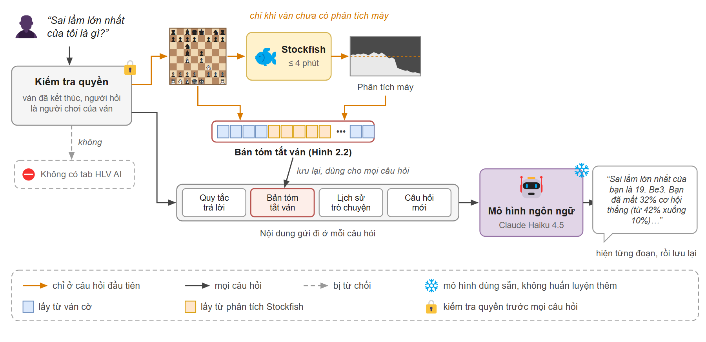
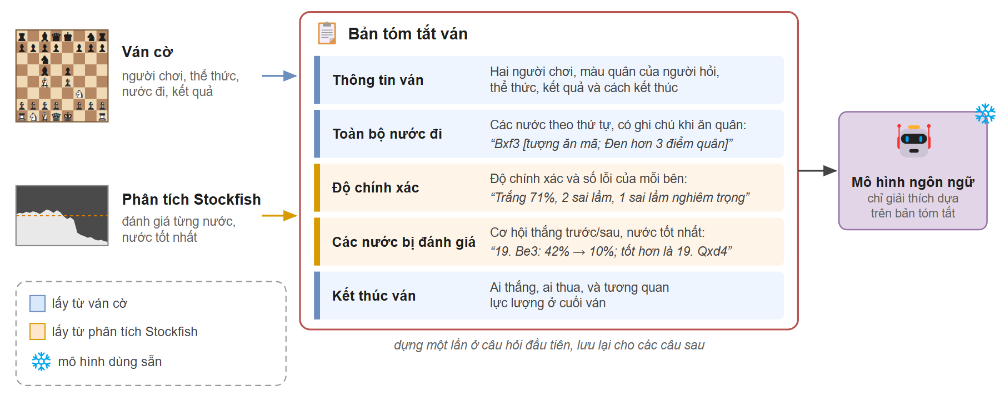
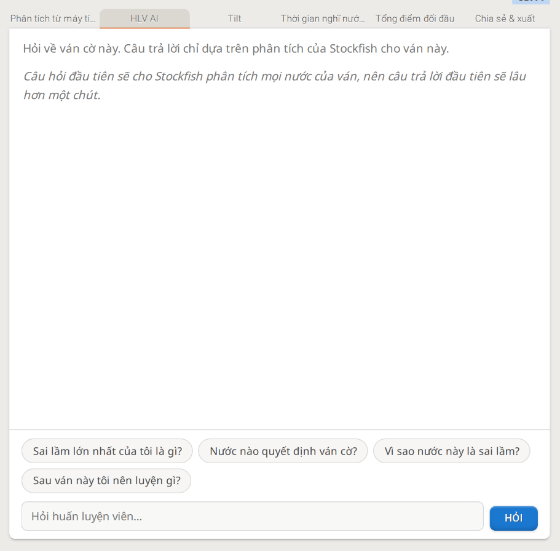
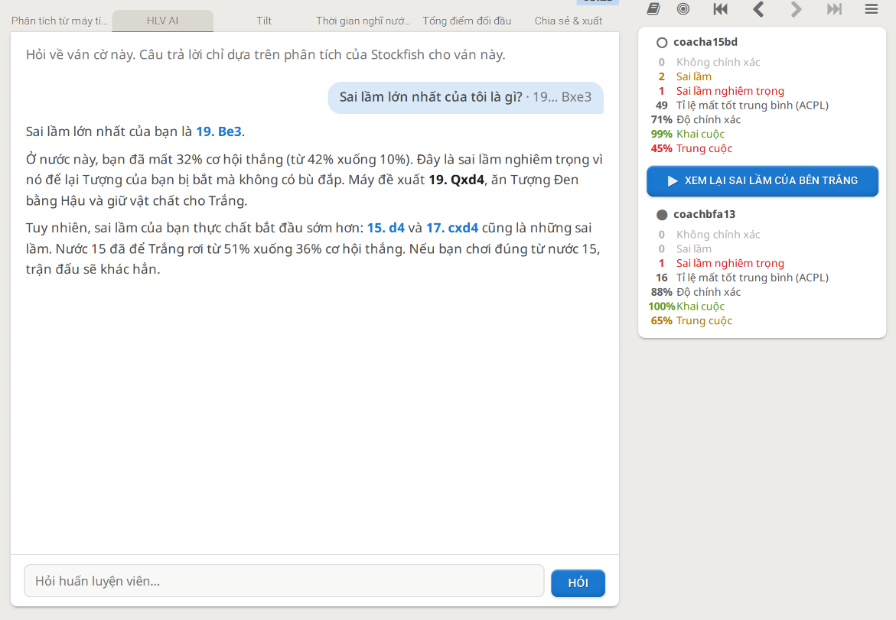

# AI Coach: huấn luyện viên AI

Sau một ván cờ, người chơi thường muốn biết mình sai ở đâu và nên học gì. Phân
tích máy của Lichess cho biết đánh giá thế cờ và nước tốt nhất theo Stockfish,
nhưng chỉ bằng con số và chuỗi nước đi, khó hiểu với người mới. AI Coach cho phép
người chơi hỏi bằng tiếng Việt hoặc tiếng Anh về ván vừa chơi và nhận câu trả lời
bằng lời từ một mô hình ngôn ngữ lớn.

Mô hình ngôn ngữ dễ "bịa" khi nói về cờ: nhắc tới nước không có trong ván, hoặc
đánh giá sai thế cờ. Vì vậy AI Coach không để mô hình tự phân tích. Hệ thống đưa
cho mô hình một bản tóm tắt ván dựng từ kết quả phân tích của Stockfish, và yêu
cầu mô hình chỉ giải thích dựa trên bản tóm tắt đó.

## Chức năng

- **Tab "HLV AI" trong trang xem lại ván.** Tab chỉ có sau khi ván kết thúc và
  chỉ với hai người chơi của ván; mỗi người có cuộc trò chuyện riêng. Trong lúc
  đang chơi, hoặc với người xem, tab không tồn tại và `/game/{id}/ai-coach` trả
  404, nên không thể dùng AI Coach để nhận gợi ý nước đi khi đang chơi.
- **Câu hỏi gợi ý và câu hỏi tự do.** Tab có sẵn bốn câu hỏi: "Sai lầm lớn nhất
  của tôi là gì?", "Nước nào quyết định ván cờ?", "Vì sao nước này là sai lầm?" và
  "Sau ván này tôi nên luyện gì?". Người chơi cũng có thể gõ câu hỏi riêng. Nếu
  người chơi đang xem một nước cụ thể trên bàn cờ, câu hỏi được gắn với nước đó.
- **Tự phân tích ván.** Nếu ván chưa có phân tích máy, câu hỏi đầu tiên tự gửi ván
  đi phân tích bằng Stockfish, báo trạng thái chờ, rồi trả lời khi phân tích xong.
- **Trả lời dần từng đoạn.** Câu trả lời hiện dần trong lúc mô hình đang viết.
  Nước đi được nhắc trong câu trả lời, nếu đúng là nước đã đi trong ván, bấm được
  để bàn cờ nhảy tới nước đó.
- **Giới hạn:** 50 câu hỏi mỗi ngày cho mỗi người, 30 lượt mỗi ván.

## Thiết kế

AI Coach nối ba thành phần:

1. máy chủ lila nhận câu hỏi, kiểm tra quyền và lưu cuộc trò chuyện;
2. hàng đợi phân tích máy có sẵn của Lichess (fishnet), nơi Stockfish phân tích
   ván;
3. mô hình ngôn ngữ Claude của Anthropic, gọi qua một cổng API.



*Các bước trả lời một câu hỏi của người chơi.*

### Phân tích ở câu hỏi đầu tiên

- Ván chưa có phân tích thì `AiCoachApi.ask` gửi ván vào hàng đợi phân tích
  (người hỏi là người gửi) và trả `{"status":"analysing"}`.
- Sau đó cứ 2 giây đọc lại kết quả, tối đa 4 phút. Người chơi kia hỏi trong lúc
  đó thì đợi chung.
- Lỗi được báo riêng: hàng đợi bận, hết lượt phân tích, ván không phân tích được,
  phân tích thất bại.
- Với fishnet local (8 engine × 500.000 nút), một ván 38 nửa nước mất khoảng 9
  giây.

### Bản tóm tắt ván

Bản tóm tắt là phần quan trọng nhất để câu trả lời đúng. Lila đi lại toàn bộ ván
bằng scalachess để ghi rõ từng sự kiện, nhờ đó mô hình không phải tự suy ra thế
cờ. Bản tóm tắt chỉ dựng một lần ở câu hỏi đầu tiên và được dùng lại cho các câu
sau.



*Nội dung bản tóm tắt ván gửi cho mô hình ngôn ngữ.*

- **Thông tin ván:** hai người chơi, màu quân của người hỏi, thể thức, kết quả,
  cách kết thúc.
- **Toàn bộ nước đi:** theo thứ tự, có ghi chú khi ăn quân hoặc phong cấp, ví dụ
  `Bxf3 [bishop takes knight; material Black +3]`.
- **Độ chính xác:** độ chính xác và số lỗi của mỗi bên.
- **Các nước bị đánh giá:** cơ hội thắng trước và sau, nước tốt nhất và biến của
  Stockfish, cũng có ghi chú ăn quân.
- **Kết thúc ván:** ai thắng, ai thua, và tương quan lực lượng cuối ván.

### Quy tắc trả lời

Kèm theo bản tóm tắt là các quy tắc:

- chỉ nói một bên mất quân khi bản tóm tắt có ghi chú tương ứng;
- không tự mô tả thế cờ hay ô bị kiểm soát;
- không phán xét đối thủ có gian lận hay không;
- trả lời bằng ngôn ngữ của câu hỏi. Câu hỏi tiếng Việt có dấu được thêm
  `[Answer in Vietnamese]`, và prompt có bảng thuật ngữ cờ vua để dùng từ thống
  nhất.

### Truyền câu trả lời

Mô hình trả về từng đoạn (SSE). Lila chuyển tiếp cho trình duyệt dạng ndjson:
mỗi dòng `{"d": "..."}` là một đoạn chữ, dòng cuối là `{"turn": ...}` khi xong
hoặc `{"error": ...}` khi lỗi. Cứ 50 giây lila gửi một dòng trống để giữ kết nối.
Mỗi lượt lưu thời gian tới chữ đầu tiên và tổng thời gian trả lời.

## Giao diện



*Tab HLV AI của một ván vừa kết thúc.* Lời giới thiệu cho biết câu trả lời chỉ
dựa trên phân tích của Stockfish cho ván này, và câu hỏi đầu tiên sẽ cho
Stockfish phân tích mọi nước nên trả lời lâu hơn một chút. Bên dưới là bốn câu
hỏi gợi ý và ô nhập câu hỏi.



*Một lượt hỏi đáp.* Người chơi hỏi "Sai lầm lớn nhất của tôi là gì?" khi đang
xem nước 19... Bxe3, nên câu hỏi được gắn với nước này. Câu trả lời chỉ ra nước
làm mất nhiều cơ hội thắng nhất, nêu cơ hội thắng giảm từ 42% xuống 10%, đưa ra
nước Stockfish đề xuất, rồi nhắc thêm hai sai lầm trước đó.

## Cấu hình

AI Coach tắt cho tới khi có API key. Cấu hình nằm trong khối `aiCoach` của
`lila/conf/base.conf`, mỗi giá trị đọc được từ biến môi trường:

| Biến | Mặc định | Ý nghĩa |
|---|---|---|
| `AI_COACH_PROVIDER` | `anthropic` | `anthropic` (Messages API) hoặc `openai` (API tương thích OpenAI) |
| `AI_COACH_URL` | rỗng | Địa chỉ API; rỗng là địa chỉ mặc định của nhà cung cấp |
| `AI_COACH_MODEL` | `claude-haiku-4-5-20251001` | Tên mô hình |
| `AI_COACH_API_KEY` | rỗng | API key; rỗng thì tắt AI Coach |
| `AI_COACH_EFFORT` | rỗng | Chỉ cho Claude: `low`, `medium`, `high`; rỗng là mặc định của mô hình |

Khi chạy local bằng `tilt/scripts/start-lichess.sh`, script đọc key từ tệp
`~/.ai-coach-key` (quyền 600, nằm ngoài repo) và đặt các biến trên. Biến đã có
sẵn trong shell được ưu tiên. Không ghi key vào repo hay tệp cấu hình.

**Chọn mô hình.** Ngày 18/11/2026 các cấu hình được so sánh bằng
`lila/bin/ai-coach-eval.mjs` (bộ câu hỏi cố định, đối chiếu với phân tích
Stockfish, đo độ trễ và chi phí):

- mọi cấu hình đều tìm đúng nước then chốt và không bịa nước;
- Haiku 4.5 nhanh nhất (chữ đầu tiên khoảng 3 giây) và rẻ nhất (khoảng
  0,005–0,006 USD mỗi câu), nên được chọn làm mặc định;
- Opus với effort `low` giải thích tiếng Việt kỹ nhất. Muốn dùng thì đặt
  `AI_COACH_MODEL=claude-opus-5-5`.

## Giới hạn

Thử 40 câu tiếng Việt với Haiku, số câu có lỗi giảm từ khoảng 25 (prompt v2)
xuống khoảng 7 (prompt v5). Các lỗi còn gặp:

- nhầm số nước khi có hai nước đi giống nhau trong ván;
- hiếm khi lọt chữ Trung Quốc vào câu trả lời;
- đôi khi thêm nhận xét định tính không có trong bản tóm tắt;
- nói "giữ lợi thế" khi cơ hội thắng chỉ khoảng 46–47%.

## Các tệp chính

| Tệp | Vai trò |
|---|---|
| `lila/modules/aiCoach/src/main/AiCoachApi.scala` | Kiểm tra quyền, giới hạn, tự phân tích, lưu hội thoại |
| `lila/modules/aiCoach/src/main/GameFacts.scala` | Dựng bản tóm tắt ván |
| `lila/modules/aiCoach/src/main/CoachPrompt.scala` | Prompt và quy tắc trả lời |
| `lila/modules/aiCoach/src/main/CoachLlm.scala` | Gọi mô hình (Anthropic hoặc tương thích OpenAI), đọc luồng SSE |
| `lila/modules/aiCoach/src/main/CoachText.scala` | Chữ trên giao diện, tiếng Việt và tiếng Anh |
| `lila/modules/aiCoach/src/main/ui/AiCoachUi.scala` | Phần HTML của tab |
| `lila/app/controllers/AiCoach.scala` | Route `GET`/`POST /game/{id}/ai-coach` |
| `lila/ui/analyse/src/aiCoach/` | Giao diện tab: gửi câu hỏi, hiện câu trả lời dần, nước bấm được |
| `lila/bin/ai-coach-eval.mjs` | Script so sánh mô hình |

## Kiểm thử

Trong `lila/`:

```sh
sbt 'aiCoach/Test/testOnly lila.aiCoach.*'
```

18 ca: `GameFactsTest` (14 ca cho bản tóm tắt ván), `CoachTextTest` (2),
`CoachPromptTest` (1), `CoachLlmTest` (1).
