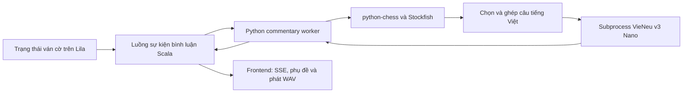

# Chức năng bình luận viên tiếng Việt

Tài liệu mô tả cấu trúc và cách vận hành phiên bản hiện tại trong workspace
Lichess local. Code và tài liệu được xây dựng với sự hỗ trợ của Codex.

## Trải nghiệm người dùng

Trong ván cờ tiêu chuẩn, người chơi bật **Bình luận tiếng Việt** ở khung ván đấu.
Chức năng hỗ trợ tài khoản đăng nhập và khách có cookie người chơi. Người xem
không được mở luồng bình luận của người chơi.

Bộ chọn dùng trực tiếp tên bình luận viên:

| Tên | ID dùng trong hệ thống | Tốc độ nói hiệu lực với cấu hình hiện tại |
|---|---|---|
| Mạnh Dũng — mặc định | `vieneu-manh-dung` | 1,20 |
| Hữu Quân | `vieneu-huu-quan` | 1,20 |
| Anh Khôi | `vieneu-anh-khoi` | 1,38 |

Lựa chọn được lưu trong trình duyệt. Nếu giá trị đã lưu không còn hợp lệ,
giao diện dùng Mạnh Dũng. Backend và frontend cùng kiểm tra danh sách ID.

Khi chọn người mới, lời đang phát dừng lại và trình duyệt phát câu chào của
giọng đó. Ba câu chào là:

- “Xin chào, tôi là Mạnh Dũng, sẽ cùng bạn tận hưởng ván cờ này.”
- “Xin chào, tôi là Hữu Quân, sẽ cùng bạn tận hưởng ván cờ này.”
- “Xin chào, tôi là Anh Khôi, sẽ cùng bạn tận hưởng ván cờ này.”

Lời bình có phụ đề riêng. Âm lượng theo âm lượng trang. Nếu tổng hợp giọng
thất bại và kết quả còn hợp lệ, giao diện vẫn có thể hiển thị phụ đề.

## Kiến trúc



Lila giữ trạng thái ván cờ chính thức. Phân tích và tạo âm thanh chạy ở worker
riêng, không được chờ trong vòng xử lý nước đi. Stockfish dùng để máy chơi cờ
và Stockfish dùng trong worker bình luận là hai luồng công việc riêng.

### 1. Nhận sự kiện và tạo công việc

`CommentaryStream.scala` đăng ký sự kiện nước đi, hoàn tác và kết thúc ván.
Mỗi trạng thái có request ID, revision, thời điểm nhận và hạn sử dụng. Snapshot
gửi tới worker gồm game ID, FEN ban đầu, toàn bộ lịch sử SAN, FEN hiện tại,
trạng thái và kết quả chính thức; các câu lúc chờ có thêm thông tin đồng hồ.

Lịch sử đầy đủ giúp dựng lại thế cờ, quyền nhập thành, bắt tốt qua đường và
các tình huống lặp. Hệ thống không dùng số ply làm định danh duy nhất của thế cờ.
Một subscription chỉ giữ công việc đang xử lý và trạng thái mới nhất đang chờ.

`CommentaryRequests.scala` chia sẻ công việc khi các subscriber có cùng snapshot
và cùng lựa chọn giọng. Mỗi subscriber vẫn giữ định danh riêng. Khi subscriber
cuối cùng rời công việc, Lila gửi yêu cầu hủy cho worker.

### 2. Trích xuất dữ kiện và tạo lời bình

`core.py` và `chess_history.py` dùng python-chess để kiểm tra snapshot, dựng bàn
cờ và xác định các sự kiện: quân di chuyển, bắt quân, chiếu, nhập thành, phong
cấp, trạng thái kết thúc và các dữ kiện vị trí liên quan.

Với lời bình nước đi, worker có thể phân tích thế cờ trước và sau bằng Stockfish.
Cấu hình mặc định dùng một luồng, Hash 16 MiB và ngân sách tìm kiếm cơ bản
100 ms mỗi thế cờ. Một số tình huống nhạy cảm được kiểm tra sâu hơn. Khi engine
không sẵn sàng, hệ thống vẫn có phần mô tả dựa trên dữ kiện bàn cờ.

Nội dung được chọn từ kho câu viết sẵn `phrases.py`, phiên bản `vi-prebuilt-2`.
`insight.py` cung cấp các mẫu nhận xét; `narrative.py` ghép phần mô tả sự kiện
với nhận xét phù hợp. Không dùng mô hình ngôn ngữ để tự viết lời bình.

`Recent` lưu tối đa 16 mục lời bình gần đây cho mỗi ván, tối đa 64 ván trong
RAM. Bộ chọn so sánh cả khung câu để hạn chế lặp cấu trúc, không chỉ lặp nguyên
văn. Khi các nước đi cách nhau dưới 3,5 giây, ưu tiên câu ngắn và giảm lời dẫn.

Lời bình gồm bốn loại: chào đầu ván, nước đi, lúc chờ và kết thúc. Câu lúc chờ
bắt đầu sau 10 giây, rồi cách nhau 15 giây, tối đa bốn lần cho một thế cờ; chúng
không chạy phân tích Stockfish mới. Kết quả chính thức của ván quyết định lời
kết thúc. Các nhận xét dựa trên engine vẫn là heuristic, có thể có sai sót.

Trước khi tổng hợp âm thanh, `speech_text` chuyển cách viết dành cho phụ đề
sang cách đọc: ví dụ `f3` thành “ép ba”, đồng thời chuẩn hóa số và thuật ngữ.

### 3. Tổng hợp giọng bằng VieNeu v3 Nano

`nano_worker.py` chạy bằng Python trong `.venv-nano`, tách khỏi môi trường HTTP
worker. Model được nạp một lần, giữ trong tiến trình để phục vụ nhiều câu.
Giao tiếp giữa hai tiến trình là JSON từng dòng: văn bản và ID giọng ở đầu vào,
WAV mã hóa base64 ở đầu ra.

Model hoạt động trên CPU qua ONNX Runtime, xuất mono PCM 16-bit, 24 kHz. Cấu
hình vận hành dùng 16 bước và một luồng CPU. Tốc độ nền là 1,2; hệ số riêng của
Anh Khôi là 1,15 nên tốc độ hiệu lực là 1,38. Hai giọng còn lại giữ hệ số 1,0.
Giới hạn tốc độ hiệu lực là 2,0. Tham số tốc độ tác động trong model, không đổi
tần số phát WAV.

`nano_audio.py` chuyển float sang PCM. Với đỉnh vượt 0,9 toàn thang, nó hạ biên
độ theo tỉ lệ để giữ hình dạng tín hiệu, không cắt đỉnh phẳng và không khuếch
đại âm thanh nhỏ. Xử lý này không bảo đảm loại bỏ các hiện tượng do model tạo ra.

Model và dependency được cố định để có thể dựng lại:

- SDK: `vieneu==3.8.4`, dependency trong `requirements-vieneu.lock`.
- Model: `pnnbao-ump/VieNeu-TTS-v3-Nano`, revision
  `aba295eb96a6fa6003ebe417cc1f2802a7adc1dc`.
- Sáu tệp suy luận có URL và SHA256 trong `nano-assets.json`.
- Model được khai báo theo Apache-2.0; không dùng voice cloning cho ba preset.

### 4. Hàng chờ, cache và dữ liệu lỗi thời

Worker chỉ giữ tối đa một câu Nano đang tổng hợp. Nếu request bị hủy khi còn
chờ câu đang chạy, nó không để lại một câu tổng hợp lỗi thời trong hàng chờ.
Câu đang chạy có thể hoàn tất để tránh phải nạp lại model. Các request giống
nhau dùng chung kết quả; cache tối đa 64 mục theo cặp giọng và văn bản trong RAM.
Cache mất khi worker khởi động lại.

Mỗi công việc bình luận có hạn 12 giây; tổng hợp Nano có deadline mặc định
7 giây. Worker không có hàng đợi HTTP/UCI không giới hạn; request mới chỉ chờ
worker bận trong một khoảng hữu hạn trước khi nhận lỗi bận.

Lila chỉ gửi kết quả còn thuộc trạng thái mới nhất. Frontend kiểm tra lại game,
subscription, request, revision, thế cờ, trạng thái và hạn sử dụng cả khi nhận
kết quả lẫn trước khi bắt đầu phát. Lời bình Nano đến muộn hơn 4,5 giây bị loại
khi bắt đầu một lượt đọc mới. Vì vậy chơi nhanh có thể bỏ qua lời bình một số
nước; hệ thống không cố đọc lại toàn bộ backlog.

## Giao diện dịch vụ và bảo vệ truy cập

| Điểm truy cập | Vai trò |
|---|---|
| Lila `GET /commentary/{gameId}?voice={id}` | SSE cho người chơi đã được kiểm tra quyền |
| Lila `GET /commentary/voice/{id}` | Câu chào WAV của giọng trong whitelist |
| Worker `GET /health` | Trạng thái engine, backend giọng và danh sách giọng |
| Worker `GET /sample/{id}` | Tổng hợp hoặc đọc cache câu chào |
| Worker `POST /comment` | Xử lý snapshot ván cờ |
| Worker `POST /cancel/{requestId}` | Hủy công việc lỗi thời |

Worker chỉ bind `127.0.0.1:9666`; các route của worker yêu cầu bearer token
`BLV_TOKEN`. Token nằm ở cấu hình riêng phía server, không đưa xuống trình duyệt.
Lila không chuyển điểm engine/PV trong `facts` tới người chơi. Trình duyệt chỉ
nhận phần phục vụ hiển thị và phát lời bình.

Stack này dành cho phát triển local. Khả năng truy cập bằng IP WSL không đồng
nghĩa đã có cấu hình phù hợp cho public deployment.

## Cấu hình và vận hành

Launcher `./lichess-local` đọc `services/commentary/.env`; biến môi trường shell
được ưu tiên. Không commit `.env` hay chép token thật vào tài liệu. Các mục Nano:

```dotenv
BLV_TTS_PROVIDER=vieneu
BLV_NANO_DIR=/absolute/path/to/pinned-nano-model
BLV_NANO_PYTHON=/absolute/path/to/services/commentary/.venv-nano/bin/python
BLV_NANO_STEPS=16
BLV_NANO_THREADS=1
BLV_NANO_SPEED=1.2
BLV_NANO_TIMEOUT=7
BLV_ENGINE_MS=100
```

Đường dẫn Python phải giữ nguyên executable của virtualenv; không thay nó bằng
đích symlink Python hệ thống. Hướng dẫn cài dependency nằm trong README dịch vụ.

Khi đổi code frontend hoặc whitelist Scala, từ `lila/` chạy:

```sh
./ui/build
./lila.sh --server --batch stage
```

Full UI build **không kèm tên package** mới tạo asset manifest để server tìm
được bundle mới. Build riêng một package không đủ cho việc cập nhật trang chạy.

Sau khi build, từ gốc workspace:

```sh
./lichess-local stop
./lichess-local --no-build
```

Mở URL launcher in ra; hiện tại là `http://172.31.8.156:9663`. IP WSL có thể
thay đổi giữa các phiên. Tạo ván tiêu chuẩn, bật bình luận và chọn từng tên.
Log nằm trong `~/.local/state/lichess-main/`; đổi cấu hình cần khởi động lại.

## Các tệp chính và kiểm tra

| Tệp | Trách nhiệm |
|---|---|
| `lila/app/controllers/Commentary.scala` | Quyền truy cập, whitelist và HTTP proxy |
| `lila/modules/round/src/main/CommentaryStream.scala` | Sự kiện ván, SSE, revision và công việc mới nhất |
| `lila/modules/round/src/main/CommentaryRequests.scala` | Chia sẻ công việc giữa subscriber |
| `lila/ui/round/src/commentary.ts` | Chọn giọng, câu chào, kiểm tra trạng thái và phát âm thanh |
| `lila/ui/round/src/view/commentary.ts` | Khung bình luận, phụ đề, bộ chọn tên |
| `services/commentary/app.py` | API, engine, hàng chờ và cache |
| `core.py`, `chess_history.py` | Dữ kiện và kiểm tra lịch sử thế cờ |
| `phrases.py`, `narrative.py`, `insight.py` | Mẫu câu, chọn nhận xét và ghép lời bình |
| `voices.py`, `nano_worker.py`, `nano_audio.py` | Preset, lời chào, tốc độ và âm thanh |
| `scripts/local.py` | Khởi động, readiness, log và dừng các tiến trình được quản lý |

Các test Python nằm trong `services/commentary/tests`; test UI bình luận nằm
trong `lila/ui/round/tests/commentary.test.ts`; test launcher ở `scripts/tests`.
Các bài tổng hợp thật cần model tại `BLV_NANO_DIR` và môi trường Nano đã cài.
Phải kiểm tra trang đang chạy sau build: bộ chọn có đúng ba tên, default là
Mạnh Dũng, hai ID không hợp lệ bị server từ chối và câu chào thực sự trả WAV.

Nano vẫn là model thử nghiệm. Tốc độ nói, thời gian tổng hợp và cảm nhận rõ/đều
là ba tiêu chí khác nhau; kết quả vài câu thử không thay thế benchmark hay đánh
giá nghe. Sửa đổi upstream được lưu bằng patch trong `patches/`; revision nền
ở `upstream-lock.json`, bằng chứng kiểm tra ở task list của feature.
