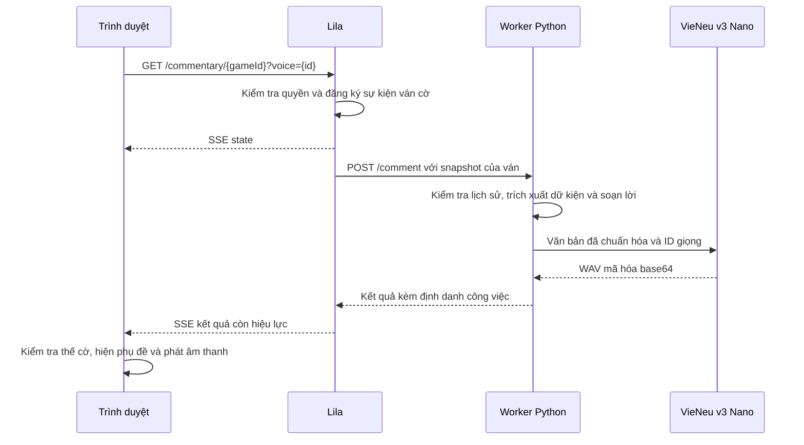

# Bình luận viên tiếng Việt

Bình luận viên tiếng Việt đọc lời bình trực tiếp khi người chơi tham gia ván cờ tiêu chuẩn. Lời bình dựa trên dữ kiện của ván cờ, các mẫu câu tiếng Việt viết sẵn và, với một số nhận xét về nước đi, phân tích ngắn của Stockfish. Dịch vụ xử lý lời bình và âm thanh độc lập với luồng xử lý nước đi của Lila.

## Sử dụng trong ván cờ

Trong trang ván đang chơi, chọn **Bật bình luận tiếng Việt** rồi chọn tên ở mục **Giọng đọc**. Tính năng dành cho người chơi được Lila xác thực qua tài khoản hoặc phiên khách. Người xem và ván luyện tập AI Coach nằm ngoài phạm vi hỗ trợ.

| Giọng đọc | ID |
|---|---|
| Mạnh Dũng (mặc định) | `vieneu-manh-dung` |
| Hữu Quân | `vieneu-huu-quan` |
| Anh Khôi | `vieneu-anh-khoi` |

Trình duyệt lưu lựa chọn giọng. Khi đổi giọng, trình duyệt kết nối lại luồng sự kiện theo lựa chọn mới và phát câu chào mẫu. Phụ đề hiển thị lời bình và có thể kèm nhãn nước đi hoặc **Đang chờ**. Âm thanh dùng mức âm lượng của trang. Nếu dịch vụ trả lời bình hợp lệ mà thiếu âm thanh, giao diện có thể hiển thị phụ đề.

## Luồng xử lý



### 1. Lila nhận sự kiện và gửi snapshot

`Commentary.stream` kiểm tra tính năng, ID giọng và quyền của người chơi trước khi mở kết nối SSE. `CommentaryStream.apply` đăng ký sự kiện nước đi, hoàn tác và kết thúc, sau đó lấy trạng thái mới nhất của ván từ Lila. Mỗi công việc mang ID yêu cầu, revision và thời hạn riêng. Snapshot gồm FEN ban đầu, lịch sử SAN đầy đủ, FEN hiện tại, trạng thái ván và bên thắng nếu có. Bình luận lúc chờ dùng thêm dữ liệu đồng hồ khi ván có đồng hồ.

Một kết nối xử lý tối đa một công việc cùng một trạng thái mới nhất đang chờ. `CommentaryRequests.apply` chia sẻ kết quả giữa các kết nối nếu dữ liệu công việc và giọng trùng nhau. Khi không còn kết nối nào cần kết quả đó, `cancelRequest` gửi yêu cầu hủy đến worker. Hoàn tác cập nhật thế cờ và loại công việc cũ. Khi kết nối lại giữa ván, trạng thái hiện tại là điểm bắt đầu để nhận sự kiện mới.

### 2. Worker dựng lại thế cờ và tạo lời bình

`core.extract` dùng `chess_history.replay` để phát lại lịch sử SAN bằng python-chess và đối chiếu với FEN hiện tại. Lịch sử đầy đủ giữ được thông tin về lặp lại thế cờ. Dữ kiện nước đi bao gồm quân di chuyển, bắt quân, chiếu, nhập thành và phong cấp.

`Worker.process` có thể gọi `Worker.analyse` để phân tích thế cờ trước và sau nước đi. Mặc định Stockfish dùng một luồng, Hash 16 MiB và ngân sách tìm kiếm cơ bản 100 ms mỗi thế cờ. Một số tình huống, như đòn chĩa có chiếu hoặc điểm đánh giá biến động lớn, được kiểm tra thêm. Khi engine không sẵn sàng, worker vẫn có thể soạn lời dựa trên dữ kiện của bàn cờ. Điểm đánh giá và biến chính của engine được giữ ở phía server.

`narrative.compose` ghép mô tả sự kiện với mẫu câu từ `phrases.py` và nhận xét theo quy tắc từ `insight.py`. Bộ chọn xét các câu gần đây để giảm lặp và ưu tiên câu ngắn khi hai nước liên tiếp cách nhau dưới 3,5 giây. Trước khi gửi sang bộ tổng hợp giọng, `core.speech_text` chuẩn hóa ký hiệu và số, chẳng hạn chuyển `f3` thành “ép ba”.

| Loại lời bình | Khi nào được tạo |
|---|---|
| Mở đầu | Khi mở luồng lúc ván đã bắt đầu và chưa có nước đi. |
| Nước đi | Khi Lila nhận trạng thái mới sau một nước đi. |
| Lúc chờ | Khi ván đang diễn ra, sau khoảng 25 giây không có cập nhật. Có thể thêm một câu sau 30 giây, tối đa hai câu cho một thế cờ trong mỗi kết nối. Dữ kiện lấy từ bàn cờ, lịch sử và đồng hồ. |
| Kết thúc | Khi worker nhận trạng thái kết thúc. Lời kết dùng dữ kiện bàn cờ, trạng thái và kết quả từ Lila. |

### 3. Tổng hợp giọng và phát kết quả

Khi đặt `BLV_TTS_PROVIDER=vieneu`, `nano_worker.py` nạp VieNeu v3 Nano trong tiến trình Python riêng và tổng hợp trên CPU qua ONNX Runtime. Tiến trình nhận văn bản và ID giọng bằng JSON từng dòng, trả WAV mono PCM 16-bit ở 24 kHz. Với tốc độ nền mặc định 1,2, Mạnh Dũng và Hữu Quân dùng mức 1,2, còn Anh Khôi dùng mức 1,38. Tệp khóa dependency và manifest model cố định phiên bản SDK, revision và SHA-256 của các tệp model. [Dependency của Nano](../../services/commentary/requirements-vieneu.lock) · [Manifest model](../../services/commentary/nano-assets.json)

Worker Nano xử lý một lượt tổng hợp tại một thời điểm và lưu tối đa 64 kết quả âm thanh trong RAM theo cặp giọng và văn bản. Một lượt tổng hợp đang chạy có thể hoàn tất sau khi yêu cầu bị hủy để tái sử dụng kết quả. Lila chỉ chuyển tiếp kết quả còn hiệu lực cho trạng thái mới nhất. Hạn của công việc Lila là 12 giây, còn giới hạn chờ tổng hợp Nano mặc định là 7 giây.

`CommentaryCtrl` kiểm tra định danh ván, kết nối, công việc, revision, hạn sử dụng và thế cờ trước khi phát. Với Nano, lúc chưa có câu nào đang phát, kết quả đến sau hơn 4,5 giây kể từ khi được tiếp nhận ở server bị bỏ qua. Câu đã phát có thể đọc hết khi có nước mới. Trong thời gian đó giao diện chỉ giữ kết quả mới nhất đang chờ và kiểm tra lại trước khi phát. Khi chơi nhanh, một số nước có thể được bỏ qua.

## Giao diện tích hợp

| Bên phục vụ | Route | Chức năng |
|---|---|---|
| Lila | `GET /commentary/{gameId}?voice={id}` | Mở luồng SSE của người chơi. Client cần truyền một ID hiện hành trong bảng giọng. Route đang có giá trị mặc định cũ `piper-vais1000`, nên bỏ tham số sẽ nhận HTTP 400 khi tính năng đã bật và có token. |
| Lila | `GET /commentary/voice/{id}` | Câu chào mẫu dạng WAV cho một ID hợp lệ. |
| Worker | `GET /health` | Báo trạng thái engine, backend giọng, danh sách giọng và trạng thái sẵn sàng. |
| Worker | `GET /sample/{voice}` | Lấy WAV của câu chào. |
| Worker | `POST /comment` | Nhận snapshot và trả lời bình, có thể kèm WAV mã hóa base64. |
| Worker | `POST /cancel/{requestId}` | Hủy công việc khi thế cờ đổi hoặc kết nối đóng. |

Tất cả route của worker yêu cầu bearer token dùng chung với Lila. Trình duyệt chỉ gọi Lila. Lila loại trường `facts` khỏi kết quả SSE trước khi gửi cho người chơi.

## Cấu hình phát triển

Cài Lila, Stockfish, worker Python và model Nano theo hướng dẫn của dự án. Tạo cấu hình từ `.env.example` trong thư mục dịch vụ và nạp các biến vào môi trường của worker trước khi chạy. Các biến chính là `BLV_TOKEN`, `BLV_STOCKFISH`, `BLV_TTS_PROVIDER=vieneu` và `BLV_NANO_DIR`. Nếu đặt môi trường Nano ở vị trí khác mặc định, trỏ `BLV_NANO_PYTHON` đến executable của môi trường đó. Worker dùng Piper khi giữ mặc định `auto`, vì vậy cấu hình Nano cần chọn `vieneu` tường minh. [Hướng dẫn cài dự án](../../README.md#cài-đặt-và-chạy) · [Hướng dẫn cài worker và model](../../services/commentary/README.md#cài-worker-và-model) · [Cấu hình mẫu](../../services/commentary/.env.example)

Ví dụ, khi Lila và worker chạy trên cùng máy, khởi động worker từ `services/commentary/` sau khi đã nạp cấu hình môi trường.

```sh
.venv/bin/python -m uvicorn app:app --host 127.0.0.1 --port 9666 --workers 1
```

Trong `lila/conf/application.conf`, bật bình luận và trỏ đến worker. Nạp cùng giá trị `BLV_TOKEN` vào môi trường của Lila.

```hocon
commentary.enabled = true
commentary.endpoint = "http://127.0.0.1:9666"
commentary.token = ${?BLV_TOKEN}
```

Giữ worker trên giao diện nội bộ và token trong cấu hình phía server. Khi thay đổi mã UI, chạy đầy đủ `./ui/build` từ `lila/` để cập nhật asset manifest. Khi thay đổi Scala hoặc route, build lại Lila theo hướng dẫn của dự án rồi khởi động lại tiến trình liên quan. [Hướng dẫn build](../../README.md#cài-đặt-và-chạy)

## Mã nguồn chính

| Phần | Điểm vào |
|---|---|
| Điều kiện hiển thị và quyền truy cập | [`JsonView.scala`](../../lila/modules/round/src/main/JsonView.scala) và [`Commentary.scala`](../../lila/app/controllers/Commentary.scala) |
| Sự kiện ván, snapshot và chia sẻ công việc | [`CommentaryStream.scala`](../../lila/modules/round/src/main/CommentaryStream.scala) và [`CommentaryRequests.scala`](../../lila/modules/round/src/main/CommentaryRequests.scala) |
| Chọn giọng, phụ đề và phát âm thanh | [`commentary.ts`](../../lila/ui/round/src/commentary.ts) và [`view/commentary.ts`](../../lila/ui/round/src/view/commentary.ts) |
| API, phân tích và điều phối tổng hợp | [`app.py`](../../services/commentary/app.py) |
| Dữ kiện và nhận xét tiếng Việt | [`core.py`](../../services/commentary/core.py), [`chess_history.py`](../../services/commentary/chess_history.py), [`narrative.py`](../../services/commentary/narrative.py), [`insight.py`](../../services/commentary/insight.py) và [`phrases.py`](../../services/commentary/phrases.py) |
| Danh sách giọng và tổng hợp WAV | [`voices.py`](../../services/commentary/voices.py), [`nano_worker.py`](../../services/commentary/nano_worker.py) và [`nano_audio.py`](../../services/commentary/nano_audio.py) |

## Kiểm tra trên trình duyệt

1. Mở một ván tiêu chuẩn với tư cách người chơi. Bật bình luận và xác nhận Mạnh Dũng là lựa chọn mặc định trên hồ sơ trình duyệt mới.
2. Đổi qua từng giọng và nghe câu chào. Đi vài nước để kiểm tra phụ đề và âm thanh, sau đó đi nhanh hoặc hoàn tác để kiểm tra lời bình đang chờ được cập nhật theo thế cờ.
3. Kết thúc ván để kiểm tra lời kết. Mở ván ở chế độ người xem để kiểm tra nút bật bình luận chỉ xuất hiện ở trang người chơi.

Độ trễ và chất lượng đọc phụ thuộc vào tài nguyên chạy model. Nhận xét dựa trên các quy tắc và lượt phân tích Stockfish ngắn nên có thể bỏ sót ý đồ chiến thuật.
