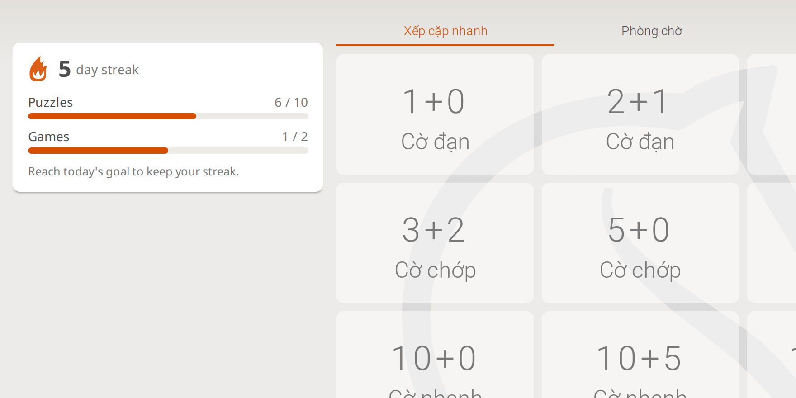
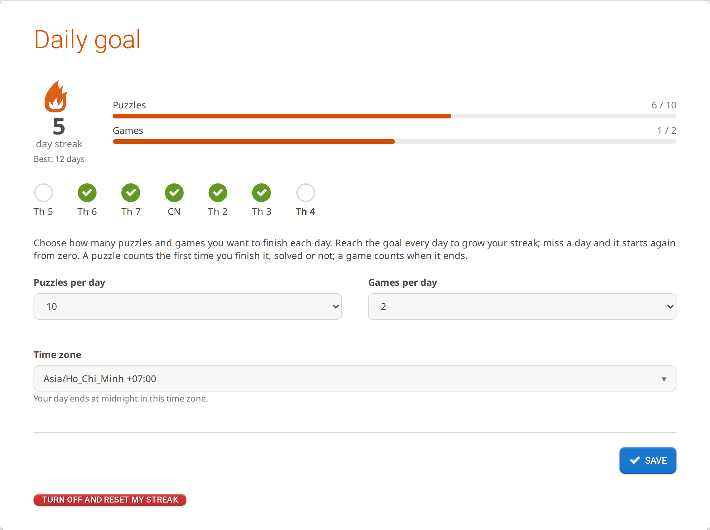

# Giao diện — Mục tiêu hằng ngày

[Tổng quan](README.md) · [Kiến trúc](kien-truc.md) · [Luồng xử lý](luong-xu-ly.md)

Hai ảnh dưới đây chụp từ bản chạy local ngày 18/11/2026, với một tài khoản thử
đặt mục tiêu 10 bài tập và 2 ván mỗi ngày. Mục tiêu được lưu qua biểu mẫu của
trang. Riêng độ dài chuỗi và tiến độ trong ngày được đặt sẵn trong DB để ảnh có
đủ các trạng thái cần minh họa.

Chữ của module viết thẳng bằng tiếng Anh, nên vẫn là tiếng Anh khi phần còn lại
của trang hiển thị tiếng Việt. Riêng tên các ngày trong tuần theo ngôn ngữ của
trang (ví dụ "Th 5", "CN").

## Thẻ trên trang chủ

Thẻ nằm ở góc trên bên trái trang chủ, cạnh khu vực ghép cặp nhanh. Chỉ người
đã đăng nhập (và không phải bot) mới thấy thẻ. Bấm vào thẻ sẽ mở trang cài đặt.

| Trạng thái | Nội dung thẻ |
|---|---|
| Chưa đặt mục tiêu | Lời mời: **Set a daily goal** — "Solve puzzles and play every day to build a streak" |
| Đã đặt, hôm nay chưa đạt, đang có chuỗi | Chuỗi kèm biểu tượng ngọn lửa, thanh tiến độ, dòng "Reach today's goal to keep your streak." |
| Đã đặt, hôm nay chưa đạt, chưa có chuỗi | Như trên, dòng cuối là "Reach today's goal to start a streak." |
| Hôm nay đã đạt | Thẻ đổi sang kiểu "đã xong", dòng cuối là "Goal reached today. See you tomorrow!" |

Cách hiện thanh tiến độ:

- Chỉ hiện thanh của chỉ tiêu lớn hơn 0. Ví dụ mục tiêu "0 bài tập, 1 ván" chỉ
  có thanh **Games**.
- Số đếm hiện tối đa bằng chỉ tiêu (làm 12 bài với chỉ tiêu 10 vẫn hiện
  `10 / 10`), và thanh đầy thì đổi sang màu "đã xong".
- Con số trên thẻ chỉ cập nhật khi tải lại trang.

## Trang cài đặt `/account/daily-goal`

Trang nằm trong khu vực tài khoản, mở từ mục **Daily goal** trong menu bên trái
hoặc từ thẻ trang chủ.

**Phần tóm tắt** (chỉ hiện khi đã có mục tiêu):

- số ngày của chuỗi hiện tại kèm ngọn lửa, và dòng **Best** (chuỗi dài nhất);
- hai thanh tiến độ của hôm nay, giống thẻ trang chủ;
- hàng bảy ngày gần nhất, cũ trước mới sau. Ngày đạt có dấu tích xanh, hôm nay
  được in đậm.

**Biểu mẫu:**

- một đoạn giải thích ngắn về cách tính bài tập, ván và chuỗi;
- **Puzzles per day** và **Games per day**, mỗi ô là một danh sách chọn;
- **Time zone**: ô chọn múi giờ có tìm kiếm, kèm ghi chú "Your day ends at
  midnight in this time zone." Với mục tiêu mới, trình duyệt tự chọn múi giờ
  của máy;
- nút **Start** khi tạo mục tiêu mới, **Save** khi sửa.

**Nút tắt** (chỉ hiện khi đã có mục tiêu): nút đỏ **Turn off and reset my
streak**. Bấm vào sẽ hiện hộp xác nhận "Turn off your daily goal? Your streak
will be lost." trước khi xóa.

**Thông báo:**

- Lưu hoặc tắt thành công thì trang tải lại và hiện thông báo thành công của
  lila.
- Chọn 0 bài tập và 0 ván thì trang hiện lỗi "Choose at least one puzzle or one
  game." ở đầu biểu mẫu, và không lưu gì.

## Kiểu hiển thị

Toàn bộ CSS nằm trong `lila/ui/lib/css/component/_daily-goal.scss`, dùng chung
cho trang chủ (`lobby.scss`) và trang tài khoản (`user.account.scss`). Có ba
khối class:

- `.daily-goal-tasks`: các thanh tiến độ;
- `.daily-goal-home`: thẻ trang chủ, với các biến thể `--off` và `--done`;
- `.daily-goal`: trang cài đặt.

Màu lấy từ biến theme của lila (ví dụ `$c-good` cho dấu tích), nên hiện đúng ở
cả giao diện sáng và tối.
