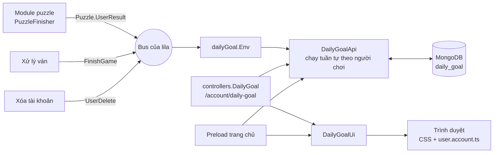

# Kiến trúc — Mục tiêu hằng ngày

[Tổng quan](README.md) · [Giao diện](giao-dien.md) · [Luồng xử lý](luong-xu-ly.md)

## Tổng quan

Daily Goal là một module lila như các module có sẵn. Nó nghe ba sự kiện trên
Bus nội bộ của lila, lưu một tài liệu cho mỗi người chơi trong MongoDB, và hiện
kết quả ở trang chủ và trang tài khoản.



Bus là kênh sự kiện chạy trong cùng tiến trình lila, khác Redis Pub/Sub mà lila
dùng để nói chuyện với lila-ws. Nhờ Bus, module không phải gọi vào hay sửa code
của phần bài tập và phần ván đấu.

## Thành phần

| Tệp | Vai trò |
|---|---|
| `lila/modules/dailyGoal/src/main/DailyGoal.scala` | Lớp dữ liệu và toàn bộ quy tắc tính tiến độ, ngày, chuỗi. Không truy cập DB nên test đơn vị trực tiếp được. |
| `lila/modules/dailyGoal/src/main/DailyGoalApi.scala` | Đọc/ghi MongoDB, cho các cập nhật của cùng một người chơi chạy lần lượt. |
| `lila/modules/dailyGoal/src/main/DailyGoalForm.scala` | Biểu mẫu Play: danh sách lựa chọn, múi giờ hợp lệ, ít nhất một chỉ tiêu. |
| `lila/modules/dailyGoal/src/main/Env.scala` | Tạo collection, tạo `DailyGoalApi`, đăng ký nghe ba sự kiện trên Bus. |
| `lila/modules/dailyGoal/src/main/ui/DailyGoalUi.scala` | Giao diện Scalatags: trang cài đặt và thẻ trang chủ. |
| `lila/modules/dailyGoal/src/test/DailyGoalTest.scala` | 8 ca test đơn vị. |
| `lila/app/controllers/DailyGoal.scala` | Ba action: mở trang, lưu, tắt mục tiêu. |
| `lila/conf/routes` | `GET /account/daily-goal`, `POST /account/daily-goal`, `POST /account/daily-goal/off`. |
| `lila/app/mashup/Preload.scala` | Đọc mục tiêu của người chơi khi dựng trang chủ. |
| `lila/app/views/lobby/home.scala` | Đặt thẻ lên trang chủ, chỉ cho người đã đăng nhập và không phải bot. |
| `lila/app/views/ui.scala` | Nối `DailyGoalUi` với khung trang tài khoản `AccountPage`. |
| `lila/modules/pref/src/main/ui/AccountUi.scala` | Mục **Daily goal** trong menu tài khoản. |
| `lila/ui/lib/css/component/_daily-goal.scss` | Kiểu hiển thị chung, được `lobby.scss` và `user.account.scss` import. |
| `lila/ui/user/src/user.account.ts` | Điền sẵn múi giờ của trình duyệt cho mục tiêu mới, bật ô chọn có tìm kiếm. |
| `lila/build.sbt`, `lila/app/Env.scala`, `lila/app/Lila.scala` | Khai báo module (phụ thuộc `puzzle`) và nạp vào ứng dụng. |

## Dữ liệu

Collection `daily_goal`, mỗi người chơi một tài liệu, khóa `_id` là mã người
chơi. Ngày lưu dạng chuỗi `YYYY-MM-DD`, múi giờ lưu theo tên múi giờ.

| Trường | Ý nghĩa |
|---|---|
| `_id` | Mã người chơi |
| `puzzles`, `games` | Số bài tập và số ván cần hoàn thành mỗi ngày |
| `zone` | Múi giờ dùng để xác định ngày của người chơi |
| `day` | Ngày mà `nbPuzzles`, `nbGames` đang đếm |
| `nbPuzzles`, `nbGames` | Số bài tập và số ván đã hoàn thành trong `day` |
| `streak`, `best` | Chuỗi tính tới ngày đạt gần nhất, chuỗi dài nhất từng đạt |
| `lastDone` | Ngày đạt gần nhất (không có nếu chưa đạt ngày nào) |
| `doneDays` | Các ngày đạt, mới nhất trước, giữ tối đa 31 ngày |

Ví dụ:

```json
{
  "_id": "alice",
  "puzzles": 10, "games": 2, "zone": "Asia/Ho_Chi_Minh",
  "day": "2026-11-18", "nbPuzzles": 6, "nbGames": 1,
  "streak": 5, "best": 12, "lastDone": "2026-11-17",
  "doneDays": ["2026-11-17", "2026-11-16", "2026-11-15", "2026-11-14", "2026-11-13"]
}
```

Collection chỉ dùng chỉ mục `_id` mặc định, vì mọi truy vấn đều theo mã người
chơi.

## Quyết định thiết kế

**Nghe sự kiện thay vì sửa code có sẵn.** Module puzzle phát
`Puzzle.UserResult` ở lần đầu người chơi hoàn thành một bài. Phần xử lý ván
phát `FinishGame` khi ván kết thúc. Daily Goal chỉ đăng ký nghe hai sự kiện này
cùng `UserDelete`, nên luồng xử lý gốc của Lichess không đổi.

**Quy tắc nằm trong lớp dữ liệu.** `DailyGoal` là một case class bất biến. Các
hàm `record`, `withSettings`, `progress`, `currentStreak`, `week` nhận thời điểm
hiện tại làm tham số và trả về bản mới, nên test được mà không cần DB hay đồng
hồ thật.

**Cập nhật tuần tự theo người chơi.** Một bài tập và một ván có thể kết thúc gần
như cùng lúc. Nếu hai lần cập nhật cùng đọc tài liệu cũ rồi ghi đè nhau thì sẽ
mất một lần đếm. `DailyGoalApi` dùng `AsyncActorSequencers` của lila, khóa theo
mã người chơi (hàng đợi tối đa 64 việc, mỗi việc tối đa 5 giây), để mọi thao
tác đọc-sửa-ghi của cùng một người chạy lần lượt. Thao tác lưu cài đặt và tắt
mục tiêu cũng đi qua cùng hàng đợi đó.

**Ngày theo múi giờ của người chơi.** Thời điểm hiện tại được đổi sang ngày địa
phương bằng `ZoneId` lưu trong tài liệu. Với người chơi ở Việt Nam (UTC+7), ngày
mới bắt đầu lúc 0 giờ giờ Việt Nam, không phải 7 giờ sáng như khi tính theo UTC.

**Không có tác vụ chạy lúc nửa đêm.** Tiến độ của một ngày cũ được coi là 0 ngay
khi đọc (`progress` so `day` với hôm nay). Chuỗi hiển thị cũng được tính lúc đọc
(`currentStreak` xem `lastDone` có phải hôm nay hoặc hôm qua không). Vì vậy
trường `streak` trong DB có thể là giá trị cũ, nhưng giao diện luôn hiện đúng.

**Trang chủ không chậm thêm.** `Preload` đọc mục tiêu song song với truy vấn lớp
học có sẵn, nên không thêm một bước truy vấn tuần tự nào. Tài khoản bot không
được đọc.

**Chi phí.** Mỗi ván kết thúc tạo một lần đọc theo `_id` cho mỗi người chơi có
tài khoản, kể cả người chưa đặt mục tiêu; với người chưa đặt mục tiêu, module
dừng ngay sau lần đọc đó. Chỉ người có mục tiêu mới có lượt ghi, dạng upsert một
tài liệu.
