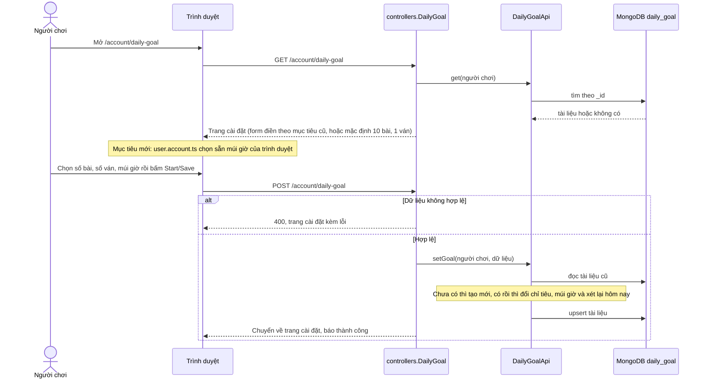
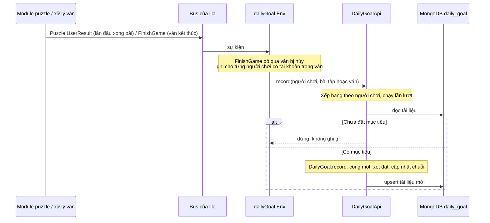
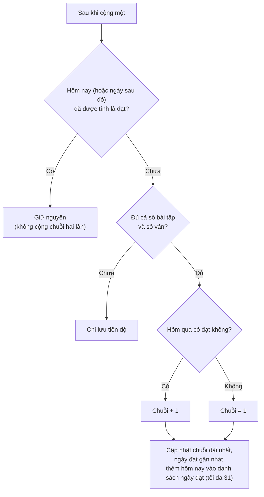

# Luồng xử lý — Mục tiêu hằng ngày

[Tổng quan](README.md) · [Kiến trúc](kien-truc.md) · [Giao diện](giao-dien.md)

## 1. Đặt hoặc sửa mục tiêu

Biểu mẫu chỉ nhận giá trị có trong danh sách lựa chọn (0, 3, 5, 10, 15, 20, 30
bài tập; 0, 1, 2, 3, 5 ván), một múi giờ hợp lệ, và tổng hai chỉ tiêu lớn hơn 0.

Sau khi đổi chỉ tiêu, hệ thống xét lại hôm nay ngay. Nếu tiến độ hiện có đã đủ
chỉ tiêu mới thì hôm nay được tính là đạt luôn.

## 2. Ghi nhận bài tập và ván

- **Bài tập:** module puzzle chỉ phát `Puzzle.UserResult` ở lần đầu người chơi
  hoàn thành bài đó, nên làm lại một bài cũ không được tính thêm. Giải đúng hay
  sai đều tính.
- **Ván:** mọi ván kết thúc mà không bị hủy đều được tính cho từng người chơi có
  tài khoản trong ván. Ván với máy chỉ tính cho người chơi, vì máy không có tài
  khoản.

## 3. Tính ngày, tiến độ và chuỗi

Tất cả nằm trong `DailyGoal.record`, chạy mỗi lần có một bài tập hoặc ván mới:

1. Đổi thời điểm hiện tại sang ngày địa phương theo múi giờ của người chơi (gọi
   là "hôm nay").
2. Lấy tiến độ của hôm nay. Nếu ngày đang lưu không phải hôm nay thì tiến độ coi
   như 0, nên không cần tác vụ nào chạy lúc nửa đêm để đặt lại.
3. Cộng một vào số bài tập hoặc số ván, và đặt ngày đang đếm là hôm nay.
4. Xét hôm nay đạt hay chưa theo sơ đồ dưới.

Khi hiển thị, chuỗi được tính lại theo hôm nay: nếu ngày đạt gần nhất là hôm nay
hoặc hôm qua thì hiện chuỗi đã lưu, còn cũ hơn thì hiện 0.

Ví dụ với mục tiêu 2 bài tập và 1 ván:

| Ngày | Đã làm | Kết quả |
|---|---|---|
| Thứ Hai | 2 bài, 1 ván | Đạt, chuỗi 1 |
| Thứ Ba, lúc 9 giờ | chưa làm gì | Chuỗi vẫn hiện 1, vì còn cả ngày để nối |
| Thứ Ba | 2 bài, 1 ván | Đạt, chuỗi 2 |
| Thứ Tư | không làm | — |
| Thứ Năm, lúc 9 giờ | chưa làm gì | Chuỗi hiện 0, vì đã bỏ lỡ thứ Tư |
| Thứ Năm | 2 bài, 1 ván | Đạt, chuỗi bắt đầu lại từ 1; chuỗi dài nhất vẫn là 2 |

## 4. Hiển thị trang chủ

1. Khi dựng trang chủ cho người đã đăng nhập (không phải bot), `Preload` đọc
   mục tiêu song song với truy vấn lớp học có sẵn.
2. Chưa có mục tiêu thì thẻ là lời mời đặt mục tiêu.
3. Có mục tiêu thì `DailyGoalUi.home` tính hôm nay theo múi giờ người chơi, rồi
   hiện chuỗi, tiến độ hôm nay và dòng trạng thái (đã đạt / giữ chuỗi / bắt đầu
   chuỗi).

## 5. Tắt mục tiêu và xóa tài khoản

- **Tắt:** nút **Turn off and reset my streak** hiện hộp xác nhận, rồi gửi
  `POST /account/daily-goal/off`. `DailyGoalApi.disable` xóa tài liệu của người
  chơi (qua cùng hàng đợi tuần tự), rồi trang tải lại ở trạng thái tạo mục tiêu
  mới. Chuỗi và lịch sử mất hẳn.
- **Xóa tài khoản:** lila phát `UserDelete` trên Bus, module gọi cùng hàm
  `disable` để xóa tài liệu.

## 6. Trường hợp biên

| Tình huống | Cách xử lý |
|---|---|
| Một bài tập và một ván kết thúc cùng lúc | Hai lần cập nhật xếp hàng theo người chơi, chạy lần lượt, nên không mất lần đếm nào |
| Làm thêm sau khi đã đạt | Tiến độ vẫn tăng, nhưng chuỗi không tăng lần nữa |
| Hạ chỉ tiêu giữa ngày khi tiến độ đã đủ | Hôm nay được tính là đạt ngay lúc lưu |
| Nâng chỉ tiêu sau khi đã đạt | Hôm nay vẫn giữ là đạt |
| Đổi sang múi giờ làm ngày địa phương lùi lại | Ngày đạt gần nhất đang ở "sau" hôm nay, nên một ngày không bị tính hai lần |
| Ván kết thúc lúc 23:30 và 0:30 giờ Việt Nam | Được tính vào hai ngày khác nhau theo giờ Việt Nam, dù cả hai đều là cùng một ngày UTC |
| Ván bị hủy | Không tính |
| Người chơi chưa đặt mục tiêu | Sự kiện chỉ tạo một lần đọc, không ghi gì |
| Danh sách ngày đạt dài | Chỉ giữ 31 ngày gần nhất; lịch trên trang chỉ cần 7 ngày |
