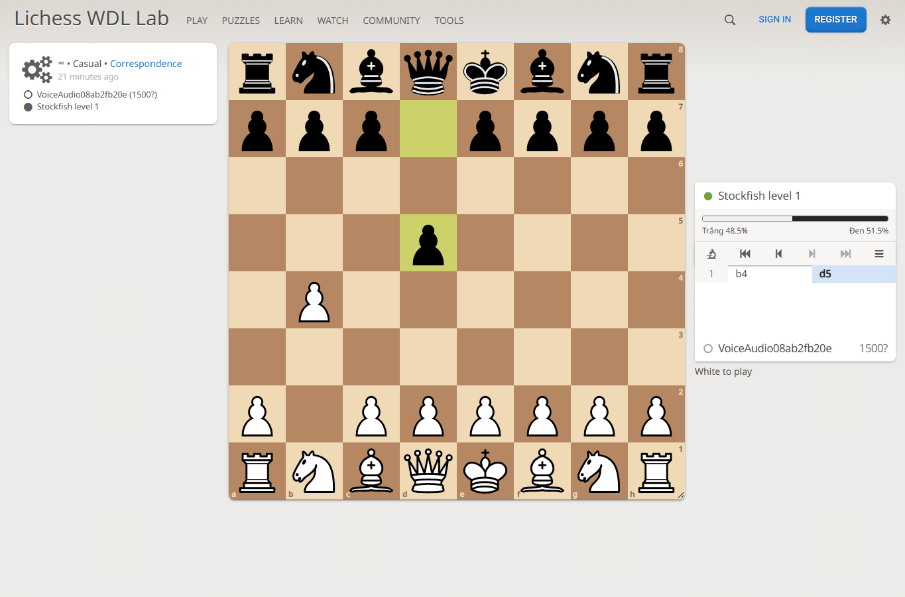

# Thanh ưu thế gọn — 18/11/2026

Đã bỏ hai dòng “Ưu thế theo engine” (hoặc nguồn human) và “50% = cân bằng ·
Hòa tính nửa điểm” khỏi phần hiển thị trực tiếp. Panel chỉ còn thanh hai màu
và hai số Trắng/Đen. Rê chuột để xem nguồn, tính chất thử nghiệm và cách tính
trong tooltip. Nhãn cho trình đọc màn hình và `data-source`/`data-metric` vẫn
được giữ; kết quả chính thức vẫn có nhãn riêng.

Không đổi công thức `W+D/2`, `B+D/2`, raw WDL, model, backend hay ASR.
[Cơ sở công thức](../expected-score-advantage/README.md).

| Kiểm tra mới chạy | Kết quả |
|---|---|
| Regression view trước sửa | 4/19 thất bại đúng vì chưa có tooltip và còn chú thích |
| Focused / toàn bộ frontend | 19/19 và 341/341, không bỏ qua |
| Production build / lint / SCSS / format | Qua, `round.CMETBTNQ.js` |
| PvP có tài khoản | 164 assertion, 44 mẫu trên hai bàn, không JS exception |
| Bot cả hai màu | 2 ván, 9 mẫu, reload/reconnect/mobile/kết quả chính thức |
| Chess960 | 404 ở server kể cả giả flags, không hiện panel |
| Bản vá | Khớp 40 đường dẫn; reverse/whitespace qua; voice patch và index thật không đổi |

[Tổng hợp](validation.json), [PvP](browser.json), [AI](ai.json),
[quan sát UI](visual.json), [patch](patch.json). Log theo tên tương ứng trong
thư mục này. Không chạy lại Scala/Python hay audio vì thay đổi chỉ ở cách hiển
thị; không dùng số kiểm thử cũ làm số đo mới. Lượt xuất patch đầu bị sandbox
chặn tiến trình Git LFS; chạy lại nguyên kiểm tra ngoài sandbox đã qua.

[Ảnh mobile](mobile.png). Vào [local](http://localhost:8080), Ctrl+F5 trên bàn
đang chơi để nhận giao diện mới. Không thực hiện nước đi trên ván người dùng.
