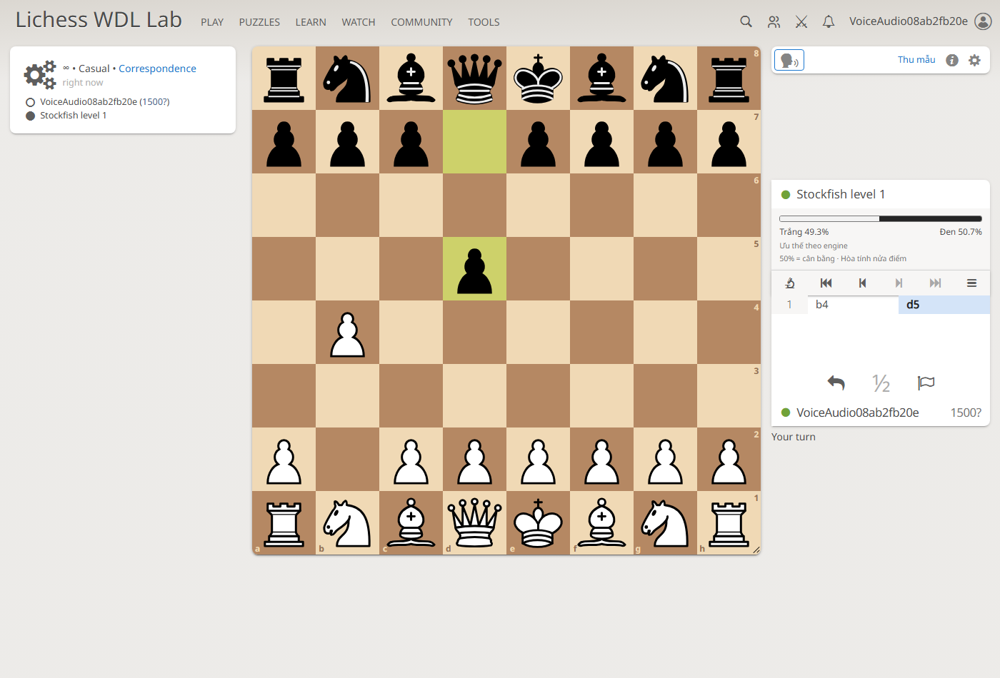

# Ưu thế Trắng/Đen theo điểm kỳ vọng — 18/11/2026

**Cập nhật giao diện sau báo cáo này:** người dùng yêu cầu bỏ hai dòng chú
thích bên dưới. Công thức giữ nguyên; nguồn và giải thích chuyển vào tooltip.
Xem [giao diện gọn hiện tại](../compact-advantage/README.md). Ảnh và kiểm thử
dưới đây được giữ làm bằng chứng cho mốc trước thay đổi trình bày.

Người dùng chọn thanh hai màu **Ưu thế**, tổng 100%, thay cho xác suất thắng
có điều kiện `W/(W+B)`. Cách cũ dễ hiện 0/100 khi phần lớn dự đoán là hòa.

Với raw WDL từ nguồn được chọn, giao diện tính:

```text
Trắng = 100 × (W + D/2) / (W + D + B)
Đen   = 100 × (B + D/2) / (W + D + B)
```

Hòa đóng góp nửa điểm cho mỗi bên; **50% là cân bằng**. Hai giá trị làm tròn
chung đến một chữ số thập phân để cộng đúng 100,0%. Mẫu số chỉ xử lý sai số
số thực của WDL hợp lệ. Đây là
[điểm kỳ vọng với thắng = 1, hòa = 0,5, thua = 0](https://python-chess.readthedocs.io/en/latest/engine.html#chess.engine.Wdl.expectation).
Đối chiếu độc lập bằng python-chess: [reference.json](reference.json).

| Raw Trắng / Hòa / Đen | Ưu thế Trắng / Đen |
|---|---|
| 0% / 87,6% / 12,4% | **43,8% / 56,2%**, thay cho 0% / 100% |
| 3,7% / 96,1% / 0,2% | 51,8% / 48,2% |
| 0% / 98% / 2% | 49% / 51% |
| 80% / 10% / 10% | 85% / 15% |
| 98% / 2% / 0% | 99% / 1% |
| 0% / 100% / 0% khi đang chơi | 50% / 50% |

Nhãn hiển thị là **“Ưu thế theo engine”** hoặc **“Ưu thế người chơi · thử
nghiệm”**, kèm **“50% = cân bằng · Hòa tính nửa điểm”**. Tooltip giải thích
nguồn. Engine chưa xét trình độ người hay cấp độ bot. Mô hình người chơi giữ
nguyên phạm vi và giới hạn trong [model card](../../human-v1/model-card.md).
Không có thay đổi huấn luyện hay kiểm định hiệu chỉnh cho cộng đồng local;
thanh này không khẳng định xác suất thắng thực tế của riêng người đang chơi.

Raw WDL, API, worker, Scala, quyền xem trên hai bàn người chơi, thứ tự ưu tiên
human/engine và giọng nói không đổi. Kết quả chính thức tiếp tục ghi đè đánh
giá: thắng là 100/0; ván hòa hiện **“Ván đấu kết thúc hòa.”** và không còn thanh
ước tính. Replay, mất kết nối, ván hủy và phản hồi cũ giữ các cơ chế bảo vệ.

## Kiểm tra đã chạy

| Kiểm tra | Kết quả | Bằng chứng |
|---|---|---|
| Regression trước sửa | 10/19 thất bại đúng với công thức/nhãn cũ | [red](red.txt) |
| Test xác suất, view và vòng đời | 19/19 qua | [focused](focused.txt) |
| Toàn bộ frontend upstream | **341/341**, 34 suite, không fail/skip | [log](ui-tests.txt) |
| Production UI, lint có kiểm tra kiểu, SCSS lint, format | Qua; bundle `round.ZESERAB3.js` | [build](build.txt), [lint](lint.txt), [SCSS](stylelint.txt), [format](format.txt) |
| PvP ẩn danh, cả hai người chơi và người xem | 188 assertion, 44 mẫu trên bàn người chơi | [JSON](browser-anonymous.json) |
| PvP có tài khoản, human model khi đủ ngữ cảnh | 164 assertion, 44 mẫu trên bàn người chơi | [JSON](browser-registered.json) |
| Bot, cầm cả hai màu | 2 ván, 9 mẫu, reload/reconnect/mobile/kết quả chính thức | [JSON](ai.json) |
| Chặn Chess960 ở server | 404 kể cả giả client flags, không có panel | [JSON](ai.json) |
| Một câu người thật đã thu | ASR → `b2b4` ngay → bot `d7d5`; đúng ưu thế trước/sau, không xác nhận | [JSON](audio.json) |
| Desktop/mobile và ván cũ | Không tràn ngang; chỉ quan sát, không đi quân trên ván người dùng | [JSON](visual.json) |
| Tái lập patch | 40 đường dẫn khớp, reverse/whitespace qua, giữ nguyên index và voice patch | [JSON](patch.json) |

Hai lượt PvP kiểm tra 88 mẫu thực từ chính hai client người chơi, bao gồm đổi
chiều bàn, replay, reload, reconnect, hoàn tác rồi thay nước ở cùng ply, kết
quả thắng/hòa và ván hủy. Không có JavaScript exception. Không chạy lại Scala
hoặc toàn bộ Python ở thay đổi giao diện này; nguồn backend/model giữ nguyên.
[Tổng hợp kiểm chứng](validation.json).

Ảnh ván test với giọng nói và ưu thế sau `b4 …d5`:



[Ảnh mobile](mobile.png), [desktop](desktop.png), [nguồn engine](engine-panel.png),
[nguồn human](human-panel.png), [kết quả hòa](official-draw.png).
Ảnh mobile cuối được chụp sau khi thông báo reconnect tạm thời của bài test
đã ẩn; không sửa CSS hoặc che thông báo để chụp ảnh.

Audio là một câu nguyên vẹn của một người nói đã dùng trong phát triển, không
phải benchmark ASR mới hoặc kiểm tra micro vật lý mới. WAV riêng không đưa lên
Git. Hai lần helper ảnh chờ nhầm panel trên ván cũ đã kết thúc bị timeout;
kiểm tra HTTP xác nhận URL đó đã trở thành trang phân tích. Ảnh live lấy từ
ván test còn đang chơi; API ván cũ xác nhận kết quả chính thức. Helper in-app
không nhận callback trước timeout, đã dừng và dọn toàn bộ tài sản tạm; không
coi yêu cầu mở tab là bằng chứng thực thi trong phiên đăng nhập của người dùng.

## Chạy lại và thử trực tiếp

Sau bootstrap/start theo README, build giao diện và khởi động lại lila:

```powershell
docker compose -f infra/compose.yml run --rm --no-deps ui bash ./ui/build --no-install -p
docker compose -f infra/compose.yml restart lila
$env:HUMAN_PLAYERS = '0'
node scripts/browser-smoke.mjs
$env:HUMAN_PLAYERS = '1'
node scripts/browser-smoke.mjs
node scripts/ai-smoke.mjs --probability --signed-in
node scripts/voice-recorded-e2e.mjs --direct --files --bot --case=file_b_short-direct --probability
```

Vào [Lichess local](http://localhost:8080), Ctrl+F5 và tạo một ván bot hoặc
người–người mới. Thanh ưu thế hiện ngay trên bàn chơi tiêu chuẩn. Giữ Shift,
đọc câu rồi thả để đi quân bằng tiếng Việt. Ván `ROwDDu2g` cũ đã kết thúc
bằng chiếu hết, Trắng thắng; mở lại URL ván đã kết thúc đi đến trang phân tích.

Các tệp chính nằm trong [patch tái lập](../../../patches/lila-win-probability.patch):
`ui/round/src/winProbability.ts`, `ui/round/src/view/winProbability.ts`,
`ui/round/css/_win-probability.scss` và hai test tương ứng. Các script browser
hiện đối chiếu điểm kỳ vọng; báo cáo điều kiện bỏ hòa trước đây được giữ làm
[lịch sử](../two-way-probability/README.md), không viết lại kết quả cũ.
