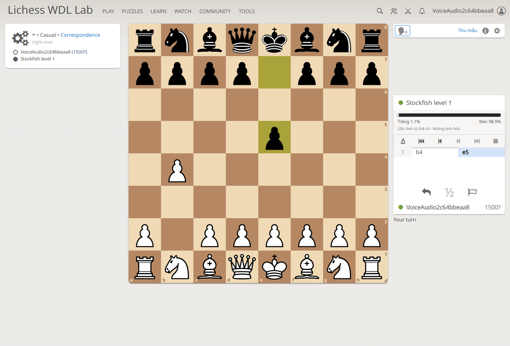

# Tỷ lệ Trắng/Đen trên bàn của mọi người chơi — 18/11/2026

Trong bản fork tự host, cả hai người chơi và người xem ván **cờ tiêu chuẩn**
đều thấy tỷ lệ ngay cạnh danh sách nước đi. Áp dụng cho người–người và chơi
với AI tích hợp; không cần tab người xem riêng.

Máy chủ cấp cờ `winProbability` trong dữ liệu bàn chơi và kiểm tra tính năng
được bật, biến thể cùng các kiểm tra chặn sẵn có ở endpoint. Các kiểm tra chống
truy cập bàn của người khác vẫn giữ nguyên. Client khởi tạo controller từ cờ
máy chủ; worker dự đoán tiếp tục nằm trong mạng Docker, dùng lịch sử ván từ
server, không nhận FEN do trình duyệt cung cấp.

Trắng và Đen vẫn là hai tỷ lệ **khi ván có bên thắng**:
`W/(W+B)` và `B/(W+B)`, làm tròn cộng đúng 100,0%. Raw WDL ba lớp, mô hình,
nguồn dữ liệu và pipeline dự đoán không đổi. Khi đủ ngữ cảnh, dùng human model
với nhãn thử nghiệm; nếu thiếu, dùng engine. Các giới hạn
[model card](../../human-v1/model-card.md) vẫn áp dụng. Kết quả chính thức ghi
đè dự đoán; hòa hoặc `W+B=0` không bị gán tỷ lệ 50/50.

## Bằng chứng

| Kiểm tra đã chạy | Kết quả | Tệp |
|---|---|---|
| Test trước sửa quyền PvP | Thất bại đúng vì HTTP 403 | [red](red.txt) |
| Toàn bộ Scala chạy bằng `testFull` | 603/603, không fail/error | [log](scala-final.txt) |
| Toàn bộ frontend | 338/338, 34 suite, không fail/skip | [log](ui-tests.txt) |
| Production UI build | Qua; `round.ESHST2TD.js` | [log](build.txt) |
| Scalafmt, type-aware lint, format | Qua | [Scala](scala-final.txt), [lint](lint.txt), [format](format.txt) |
| PvP ẩn danh: hai bàn người chơi và một người xem | 188 assertion, 44 mẫu trên bàn người chơi | [JSON](browser-anonymous.json) |
| PvP có hai tài khoản test | 164 assertion, 44 mẫu trên bàn người chơi, human model được chọn khi hợp lệ | [JSON](browser-registered.json) |
| Chơi AI, cầm cả hai màu | 2 ván, 9 mẫu tỷ lệ, reload/reconnect/mobile/kết quả chính thức | [JSON](ai.json) |
| Ngoài phạm vi Chess960 | Endpoint 404, client flags không vượt qua, không có panel | [JSON](ai.json) |
| Audio người dùng thu nguyên câu | 1/1, đi đúng `b2b4`, một nước bot hợp lệ, không hỏi xác nhận; panel trước/sau khớp server | [JSON](audio.json) |
| Patch | Khớp source ở 40 đường dẫn sau khi áp cả hai patch, reverse/whitespace qua; patch giọng nói không đổi | [JSON](patch.json) |

Hai lượt PvP đối chiếu **88 phản hồi thực tế của chính hai client người chơi**
với số trên bàn tại 22 vị trí mỗi lượt. Các ca bao gồm thay thế nước cùng ply
sau hoàn tác, đổi chiều bàn, reload người chơi, reconnect người xem, màn hình
nhỏ, thắng/thua/hòa chính thức và ván hủy. Cả hai bàn người chơi được kiểm tra
kết quả đầu hàng và hòa. Không có JavaScript exception.

Ảnh bàn test có cả giọng nói và tỷ lệ:



Lượt audio đầu chưa vào ASR vì username ngẫu nhiên của tài khoản fixture bị
server từ chối; giữ nguyên [báo cáo lỗi setup](audio-signup-rejected.json) và
[log](audio.txt). Chạy lại với danh tính test mới dùng đúng PCM, mã ASR và tiêu
chí cũ đã qua. Đây là một câu của một người nói được dùng trong phát triển,
không phải benchmark ASR mới, holdout hoặc kiểm tra micro vật lý mới. Không
đưa WAV riêng của người dùng lên Git.

Với sbt 2 đã ghim, `test` có thể chạy tăng dần;
[`testFull` chạy đầy đủ không dùng kết quả test cũ](https://www.scala-sbt.org/2.x/docs/en/reference/sbt-test.html).
Đã cập nhật `scripts/dev.ps1 check -Full` tương ứng. Lượt build cuối dùng lại
đúng 150 tài nguyên ngôn ngữ vừa được tạo và kiểm thử ở giai đoạn trước, qua
provider chỉ trong phiên build; nguồn và checksum đầu ra được xác minh trước
và sau. Không sửa build definition trong repo để bỏ bước hoặc bỏ test.
[Bằng chứng I18n](i18n-reuse.json), [tổng hợp](validation.json).

Giai đoạn chỉ mở cho AI và kiểm tra chặn PvP cũ được giữ riêng tại
[báo cáo trung gian](../ai-player-probability/README.md), không đổi tiêu chí của
những lần chạy lịch sử. Phạm vi cuối mở cho cả hai người chơi theo yêu cầu mới.

## Chạy lại và thử trực tiếp

Sau bootstrap/start theo README, chạy:

```powershell
.\scripts\dev.ps1 check -Full
docker compose -f infra/compose.yml run --rm --no-deps ui bash ./ui/build --no-install -p
docker compose -f infra/compose.yml run --rm --no-deps lila bash ./lila.sh stage
docker compose -f infra/compose.yml restart lila

$env:HUMAN_PLAYERS = '0'
node scripts/browser-smoke.mjs
$env:HUMAN_PLAYERS = '1'
node scripts/browser-smoke.mjs
node scripts/ai-smoke.mjs --probability --signed-in
node scripts/voice-recorded-e2e.mjs --direct --files --bot --case=file_b_short-direct --probability
```

Local: [bàn đang dùng](http://localhost:8080/game/ROwDDu2g?refresh=player-probability).
Tải lại bàn tiêu chuẩn của bạn, kể cả bàn người–người, để nhận bundle mới.
Giữ Shift, đọc câu lệnh rồi thả để đi ngay. Đã xác minh trong browser đang đăng
nhập `VoiceTestVN`: bàn online, vi/Shift/direct sẵn sàng, hai tỷ lệ khớp server.
Không đi quân trên ván của người dùng; helper và tệp tạm đã được dọn.
[Receipt](ready-game.json).

Các tệp chính: `app/controllers/Round.scala` và `ui/round/src/ctrl.ts` trong
[patch tái lập](../../../patches/lila-win-probability.patch). Kiểm tra browser:
[browser-smoke.mjs](../../../scripts/browser-smoke.mjs),
[ai-smoke.mjs](../../../scripts/ai-smoke.mjs),
[voice-recorded-e2e.mjs](../../../scripts/voice-recorded-e2e.mjs).
