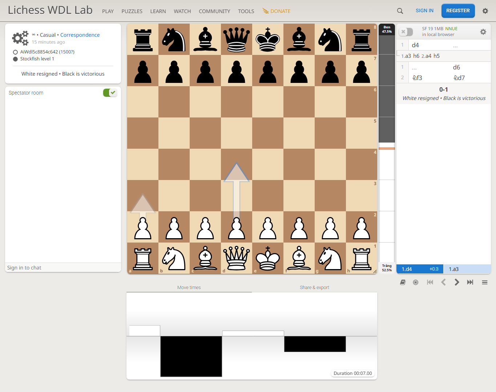

# Ưu thế Trắng/Đen trên thanh dọc khi xem lại — 18/11/2026

Trang phân tích ván standard nay hiện **Trắng / Đen và hai phần trăm** ngay
trên thanh dọc sẵn có. Thanh và panel live dùng chung một hàm:

```text
Trắng = 100 × (W + D/2) / (W + D + B)
Đen   = 100 × (B + D/2) / (W + D + B)
```

Hai số làm tròn chung để cộng đúng 100,0%; 50% là cân bằng về điểm kỳ vọng.
Không dùng `W/(W+B)` và không thêm lại hai dòng chú thích vào panel live.

## Dữ liệu và vòng đời

- Ưu tiên WDL **thật từ engine đang phân tích**. Protocol chỉ bật `UCI_ShowWDL`
  khi engine quảng bá hỗ trợ, kiểm tra bộ ba permille và đổi đúng về phía Trắng
  theo bên đến lượt, kể cả threat mode. Dữ liệu gắn với node của engine work.
- Đánh giá cũ chỉ có cp/mate dùng mô hình WDL Stockfish 15.1 rồi cùng phép tính
  điểm kỳ vọng. Đây là quy đổi được ghi rõ trong tooltip, không phải khôi phục
  WDL gốc đã mất. [Mã tham chiếu python-chess](https://python-chess.readthedocs.io/en/latest/_modules/chess/engine.html)
  và 45 vector độc lập ở [reference.json](reference.json).
- Khi tua, chỉ đọc đánh giá của node đang chọn. Thiếu đánh giá thì không giữ
  số của node trước. Đổi chiều bàn đổi vị trí nhãn, giữ đúng ý nghĩa màu.
- Kết quả ván chính thức chỉ áp tại đúng endpoint của lịch sử mainline gốc,
  có kiểm tra path/ply/FEN. Các node trước đó và nhánh phân tích cùng ply không
  nhận nhầm kết quả cuối. Chiếu hết/hòa được chứng minh từ thế cờ cũng xử lý
  được khi không có engine. Hòa ở endpoint biểu diễn điểm 50/50, có nhãn kết quả.
- Giữ toggle engine, quyền phân tích đang có và thanh cũ của biến thể khác.
  Dùng lại engine client, không thêm endpoint/worker hay dữ liệu rating/đồng hồ
  tương lai. Mobile một cột tiếp tục ẩn thanh dọc theo bố cục upstream.

**Cùng công thức không bảo đảm hai trang có số giống hệt nhau:** engine phân
tích có thể khác phiên bản/độ sâu với Stockfish live; panel live còn có thể chọn
human model. Không trộn các nguồn hoặc khẳng định đây là xác suất thắng cá nhân.

## Kiểm thử mới đã chạy

| Kiểm tra | Kết quả | Bằng chứng |
|---|---|---|
| Regression trước sửa | 9/12 thất bại đúng; 3 ca hành vi cũ vẫn qua | [red](red.txt) |
| Focused gauge/protocol/model/round | 38/38 | [log](focused.txt) |
| Toàn bộ frontend | **360/360**, 34 suite, không skip/fail | [log](ui-tests.txt) |
| WDL của cp-only | Khớp 45 vector python-chess, cả hai dấu và nhiều ply | [reference](reference.json) |
| Production build, type-aware lint, SCSS, format | Qua; `analyse.user.D6FS3B2B.js`, `round.PTUGAAIR.js` | [build](build.txt), [lint](lint.txt), [SCSS](stylelint.txt), [format](format.txt) |
| Review trong Chromium + Stockfish 19 smallnet thật | 4 ván, 22 snapshot; 18 snapshot so trực tiếp với raw WDL thật | [JSON](browser.json) |
| Đổi chiều, thiếu eval, reload, nhánh cùng ply | Đạt; PGN trên server không đổi | [JSON](browser.json) |
| Hai ván bot, panel live | Cả hai màu, 9 mẫu, kết quả chính thức và gate Chess960 | [JSON](ai.json) |
| Model browser | Tải thật và kiểm SHA256/size, chạy lại idempotent | [asset](engine-assets.json), [log](model-setup.txt) |
| Patch | 27 tệp WDL; cùng voice patch khớp 54 đường dẫn, reverse/whitespace qua | [JSON](patch.json) |

Hai ván bot vừa tạo được dùng lại để review; hai ván PvP chiếu hết/hòa lấy từ
fixture local đã kết thúc. Không tạo nước chơi trên server khi review. Snapshot
có lặp vị trí do flip/reload, không phải 22 mẫu đánh giá chất lượng độc lập.
Không có JavaScript exception ở lượt cuối. [Tổng hợp](validation.json).

Các lần chuẩn bị test từng phát hiện HTML crawler cho HeadlessChrome, giả định
sai về API/toggle của harness và một WDL cập nhật khi flip. Đã sửa harness theo
API thực: so từng snapshot với WDL của chính nó, vẫn kiểm tra giữ số khi input
tĩnh ở unit test. Build ban đầu bắt lỗi `Array.at` ngoài ES2021; đã dùng indexed
access. [Chẩn đoán](diagnostics.json). Không sửa tiêu chí toán học để bỏ qua lỗi.

Không sửa Scala, worker prediction, model hay ASR; không chạy lại backend/ASR và
không nhận số cũ làm kết quả mới. Voice patch giữ nguyên checksum.



[Đổi chiều bàn](flipped.png), [bố cục mobile](mobile.png).

## Thử và tái lập

Sau bootstrap/start:

```powershell
node scripts/prepare-analysis-engine.mjs
```

Lệnh này chỉ chuẩn bị model smallnet 1,17 MB của engine client đang có; dùng
checksum/size trong `analysis-engine-lock.json`, không tải toàn bộ model LFS.
`--refresh` kiểm tra lại bằng tải mới. Bản nhị phân không được thêm vào Git.

Mở ván đã kết thúc, Ctrl+F5, vào trang phân tích và bật engine nếu đang tắt.
Engine thử nghiệm: SF 19 1MB. Chọn nước bằng danh sách hoặc phím trái/phải;
Home/End về đầu/cuối, `f` đổi chiều. Rê chuột vào thanh để xem nguồn/cách tính.
[Ván mẫu](http://localhost:8080/game/hWI0C1QN/white#1).

Để tạo fixture mới và chạy browser smoke:

```powershell
$env:HUMAN_PLAYERS = '1'
node scripts/browser-smoke.mjs
node scripts/ai-smoke.mjs --probability --signed-in
node scripts/replay-advantage-smoke.mjs --ai-report artifacts/ai-smoke/<timestamp>/report.json
```

Các tệp chính: `ui/lib/src/ceval/wdl.ts`, `protocol.ts`, `view/main.ts`,
`ui/analyse/src/advantage.ts`, `ui/analyse/src/view/main.ts`, stylesheet và tests
tương ứng, nằm trong [patch tái lập](../../../patches/lila-win-probability.patch).
