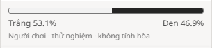

# Thanh tỷ lệ Trắng/Đen — 18/11/2026

Theo lựa chọn của người dùng, giao diện chỉ hiển thị **Trắng / Đen**, tổng
**100,0%**, với điều kiện ván có bên thắng. Không còn phân đoạn hoặc phần trăm
hòa trên thanh.



Với WDL gốc `(W, D, B)`, tỷ lệ Trắng là `W / (W + B)` và Đen là
`B / (W + B)`. Ví dụ `(0,6; 0,1; 0,3)` trở thành `66,7% / 33,3%`.
Tính trực tiếp từ xác suất gốc, làm tròn theo phần nghìn và lấy phần bù để hai
số hiển thị cộng đúng 100,0%. Nhãn nguồn có thêm “không tính hòa”; mô tả khi
rê chuột và nhãn truy cập giải thích điều kiện này.

Thanh vẫn ưu tiên mô hình người chơi khi được hỗ trợ, sau đó dùng engine.
Không trộn hai nguồn. WDL gốc, endpoint, backend và artifact mô hình giữ nguyên.
Đây là thay đổi cách hiển thị, không phải mô hình hai lớp vừa được huấn luyện
hoặc hiệu chỉnh. Các giới hạn trong [model card](../../human-v1/model-card.md)
vẫn áp dụng.

Kết quả chính thức tiếp tục ghi đè đánh giá: bên thắng nhận 100% / 0%; ván hòa
hiện “Ván đấu kết thúc hòa.” mà không có thanh/phần trăm. Nếu dự đoán có
`W + B = 0`, UI báo chưa có tỷ lệ Trắng/Đen, không tự gán 50/50. Replay,
mất kết nối, chờ đánh giá và ván hủy đều ẩn các tỷ lệ cũ.

## Kiểm tra đã thực hiện

| Kiểm tra | Kết quả | Bằng chứng |
|---|---|---|
| Test trước sửa | 6 ca thất bại trên UI cũ | [log](red.txt) |
| Test xác suất sau sửa | 16/16 qua | [log](focused.txt) |
| Toàn bộ frontend upstream | 338/338 qua, 34 suite, không fail/skip | [log](ui-tests.txt) |
| Build UI production đầy đủ | Qua; phục vụ `round.EFXWY5YN.js` | [log](build.txt) |
| Type-aware lint, stylelint, format | Qua | [lint](lint.txt), [SCSS](stylelint.txt), [format](format-check.txt) |
| Browser ẩn danh / engine | 137 kiểm tra, 0 exception | [JSON](browser-anonymous.json) |
| Browser có tài khoản / human | 113 kiểm tra, 0 exception | [JSON](browser-registered.json) |
| Hai patch trên upstream đã ghim | Áp thuận/ngược được, khớp 40 đường dẫn | [JSON](patch.json) |
| Model, patch giọng nói | SHA256 giữ nguyên | [tổng hợp](validation.json) |

Browser tạo các ván test riêng, dùng phản hồi thật của server và kiểm tra tỷ lệ
hiển thị so với `W/(W+B)` và `B/(W+B)` tại 22 vị trí mỗi lượt chạy. Các ca còn
bao gồm quyền truy cập người chơi, lật bàn, replay, reload, reconnect không tải
lại trang, hoàn tác rồi thay nước cùng ply, mobile 390 × 844 và các kết quả
chính thức: đầu hàng, chiếu hết, hòa, hủy, hết giờ. Không thao tác ván bot mà
người dùng đang dùng để thử giọng nói.

Đã xem ảnh [human trên mobile](registered-mobile.png),
[engine trên mobile](anonymous-mobile.png) và [kết quả hòa](registered-draw.png).
Không tràn ngang. Ảnh mobile chụp ngay sau ca reconnect nên còn hiệu ứng xanh
tạm thời `.online.reconnected` của upstream. Log Node có thông báo thiếu
IndexedDB của môi trường test như trước; không có test thất bại.

Không chạy lại Scala/Python cho thay đổi chỉ ở UI này; dịch vụ/model/API không
đổi. Phần chuẩn bị push giọng nói trước đó đã chạy lại 14 test dịch vụ, 6 test
Node và 13 test công cụ Python 3.12. Audio người dùng thu nguyên câu không được
đưa lên Git. Phạm vi kiểm tra này không phải benchmark độ chính xác nhận âm mới.

## Chạy lại

Từ workspace đã bootstrap theo README, chạy:

```powershell
docker compose -f infra/compose.yml run --rm --no-deps ui node ui/test --test-concurrency=2
docker compose -f infra/compose.yml run --rm --no-deps ui bash ./ui/build --no-install -p
docker compose -f infra/compose.yml restart lila

$env:HUMAN_PLAYERS = '0'
node scripts/browser-smoke.mjs
$env:HUMAN_PLAYERS = '1'
node scripts/browser-smoke.mjs
```

Local: [localhost:8080](http://localhost:8080). Mở ván ở chế độ người xem và
Ctrl+F5 để tải UI mới; người đang chơi vẫn bị chặn xem dự đoán. Các ván
acceptance đã kết thúc, nên mở chúng sẽ thấy kết quả chính thức.

Mã Lila nằm trong [patch tái lập](../../../patches/lila-win-probability.patch):
`ui/round/src/winProbability.ts`, `ui/round/src/view/winProbability.ts`,
`ui/round/css/_win-probability.scss` và hai tệp test tương ứng.
Harness: [browser-smoke.mjs](../../../scripts/browser-smoke.mjs).
Nhánh đích: `codex/vietnamese-voice-input`, tiếp sau snapshot giọng nói
`9363d208a3b1f7bf86a37fbe8a657d99e5896e79` đã xác minh trên GitHub.
