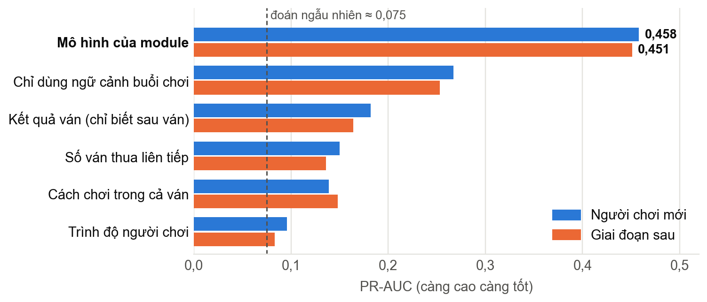
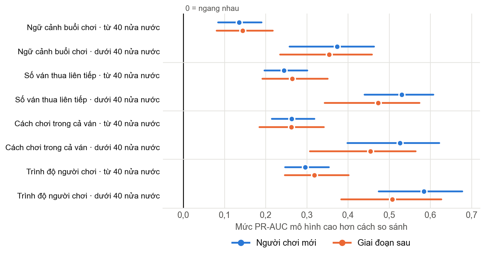
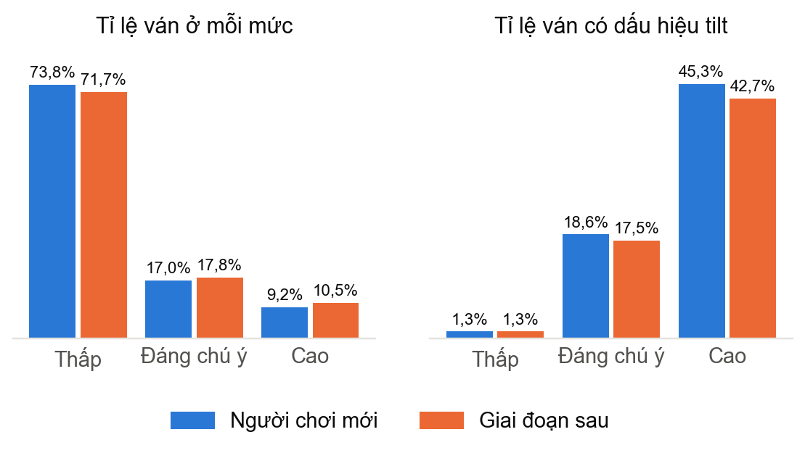

# Kết quả

## Phần đánh giá cuối

Phần đánh giá cuối gồm hai nhóm, mỗi nhóm chỉ được chấm đúng một lần:

| Nhóm | Lượt có nhãn | Trong đó TILT |
|---|---:|---:|
| A′: người chơi mới | 5.361 | 404 |
| B′: giai đoạn sau | 2.934 | 212 |

*PR-AUC trên phần đánh giá cuối; đường nét đứt là mức đoán ngẫu nhiên.*

| Chỉ số | A′ | B′ |
|---|---:|---:|
| PR-AUC của M-v3 | 0,458 | 0,451 |
| Tỉ lệ TILT (mức đoán ngẫu nhiên) | 0,075 | 0,072 |
| PR-AUC của cách so sánh tốt nhất | 0,267 | 0,253 |
| ROC-AUC của M-v3 | 0,918 | 0,916 |

- M-v3 đạt PR-AUC khoảng 0,45, gấp sáu lần đoán ngẫu nhiên và cao hơn rõ rệt
  cách tốt nhất còn lại, dù chỉ dùng 20 nửa nước đầu của ván.
- Kết quả trên người chơi mới và trên giai đoạn sau gần như nhau, nên mô hình
  không chỉ đúng với những người đã có trong dữ liệu huấn luyện.
- Sai số giữa xác suất dự đoán và tỉ lệ thật dưới 1%.
- Mô hình cũ P3-B chỉ đạt 0,11 / 0,10 trên cùng nhãn.

## Mô hình hơn thật hay do may mắn

Để chắc chắn, mức chênh PR-AUC so với bốn cách so sánh chính được đo riêng cho
ván dài (từ 40 nửa nước) và ván ngắn, kèm khoảng tin cậy 95%.

*Mô hình cao hơn từng cách so sánh bao nhiêu PR-AUC; chấm là giá trị đo, vạch
ngang là khoảng tin cậy 95%.*

Cả 16 khoảng tin cậy đều nằm hẳn bên phải vạch 0, đầu thấp nhất là +0,081, kể cả
ở nhóm ván ngắn. Mô hình được chấp nhận theo đúng quy tắc đã khóa trước.

## Ý nghĩa ba mức điểm

*Tỉ lệ ván ở mỗi mức điểm và tỉ lệ ván có dấu hiệu tilt trong mỗi mức.*

Ván ở mức Cao có tỉ lệ dấu hiệu tilt cao gấp khoảng 30 lần ván ở mức Thấp
(khoảng 45% so với 1,3%), trong khi chỉ chiếm khoảng 10% số ván. Nhờ vậy biểu
ngữ gợi ý nghỉ không hiện quá thường xuyên.

## Điểm yếu đã biết

- Ván dưới 20 nửa nước chỉ dùng đầu `pre`, nên kém hơn ván dài.
- Điểm đo mức khớp với luật v3. Luật v3 chưa được kiểm chứng bằng nhãn do người
  chơi tự báo.

## Kiểm thử

| Phần | Số ca | Lệnh |
|---|---:|---|
| Gói Python `tilt/` | 486 (484 đạt, 2 bỏ qua vì cần dữ liệu thật) | `tilt/.venv/bin/python -m pytest tilt/tests -q` |
| Module `lila/modules/tilt` | 14 | trong `lila/`: `sbt 'tilt/Test/testOnly lila.tilt.*'` |

Bộ test Python gồm phần xây dựng dữ liệu, bộ luật, mô hình và dịch vụ chấm điểm,
trong đó có các ca bảo đảm mô hình không dùng thông tin chỉ có sau thời điểm dự
đoán. Bộ test lila kiểm tra mức điểm, biểu ngữ, thống kê và chữ trên giao diện.

Điểm do dịch vụ chấm điểm tính đã được đối chiếu:

- khớp tuyệt đối với điểm tính lúc huấn luyện trên 26 người chơi, 4.150 điểm;
- sau lần sắp xếp lại mã nguồn ngày 22/11/2026, chấm lại 122 ván local (60 ván
  M-v3, 62 ván P3-B) cho kết quả giống từng byte so với trước.
