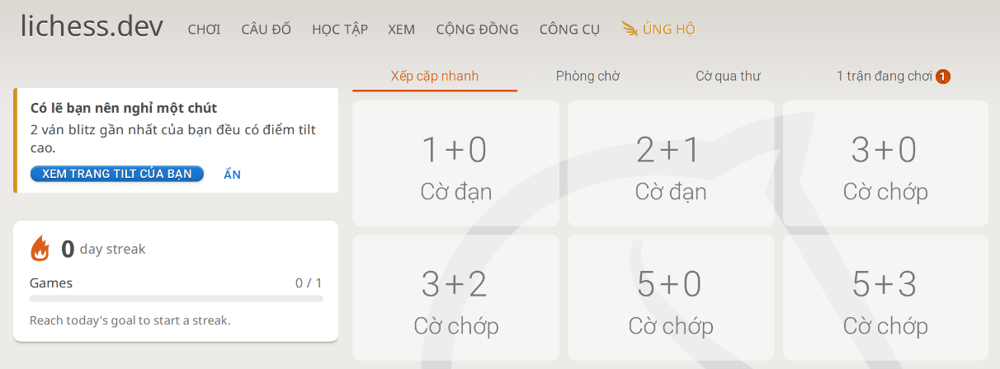
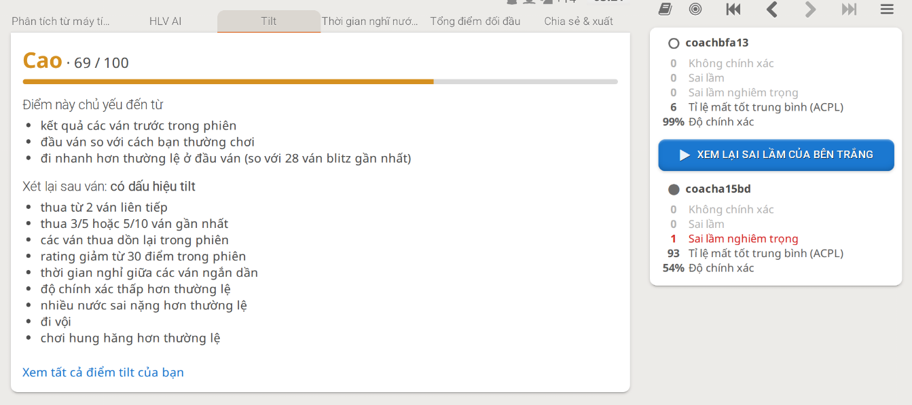
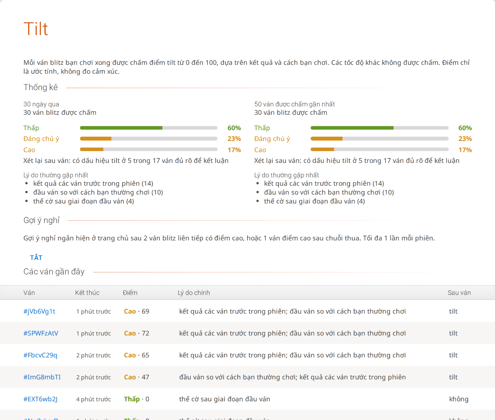

# Tổng quan

## Mục đích

Trong cờ nhanh, "tilt" là trạng thái người chơi mất bình tĩnh sau vài ván thua
liên tiếp. Họ thường vào ván mới ngay, đi vội hơn, mắc nhiều sai lầm hơn mức
thường lệ, và vì thế dễ thua tiếp. Lichess gốc không có công cụ nào giúp người
chơi nhận ra điều này.

Module Tilt bổ sung phần đó cho cờ blitz. Sau mỗi ván, hệ thống:

- ước tính mức độ ván cờ khớp với mẫu hành vi tilt;
- giải thích bằng lời thường vì sao điểm cao hay thấp;
- gợi ý nghỉ ngắn khi nhiều ván gần nhau đều có điểm cao.

Điểm tilt là ước tính dựa trên cách chơi, không đo cảm xúc thật. Điểm không ảnh
hưởng đến rating. Đối thủ và người xem không thấy điểm của người khác. Trong lúc
ván đang diễn ra, module không hiển thị gì để người chơi không bị phân tâm.

## Chức năng

**Chấm điểm từng ván blitz.** Khi ván kết thúc, mỗi người chơi nhận điểm từ 0
đến 100 và một trong ba mức:

| Mức | Điểm |
|---|---|
| Thấp | dưới 10 |
| Đáng chú ý | 10 đến dưới 30 |
| Cao | từ 30 trở lên |

Các thể thức khác blitz không được chấm.

**Tab Tilt trong trang xem lại ván.** Tab hiện điểm, mức, tối đa ba lý do chính
của điểm, và phần "Xét lại sau ván". Phần này cho biết theo bộ luật thì ván có
dấu hiệu tilt hay không, kèm các dấu hiệu đã thấy.

**Trang thống kê cá nhân `/account/tilt`.** Trang tổng hợp 30 ngày qua và 50 ván
gần nhất: tỉ lệ ván ở từng mức, các lý do hay gặp, số ván có dấu hiệu tilt và
danh sách ván gần đây.

**Gợi ý nghỉ trên trang chủ.** Biểu ngữ hiện khi:

- hai ván blitz liên tiếp đều ở mức Cao, hoặc
- một ván ở mức Cao đến sau một chuỗi thua.

Biểu ngữ hiện tối đa một lần mỗi buổi chơi, các lần cách nhau ít nhất 30 phút,
chỉ trong 30 phút sau ván cuối, và không bao giờ hiện khi người chơi đang trong
ván. Người chơi có thể ẩn biểu ngữ hoặc tắt hẳn trong trang thống kê.

## Giao diện

Ba hình dưới đây chụp từ bản chạy local ngày 19/11/2026 bằng tài khoản thử. Các
ván được chơi tự động với Stockfish, thời điểm ván được dời lại để tạo nhiều
buổi chơi vào các tối trước, cùng một buổi gần nhất có bốn ván thua liên tiếp.
Điểm trong hình do dịch vụ chấm điểm tính thật, không nhập tay.

*Biểu ngữ ở góc trên bên trái trang chủ, phía trên thẻ mục tiêu hằng ngày.* Lời
nhắc là "Có lẽ bạn nên nghỉ một chút", lý do "2 ván blitz gần nhất của bạn đều
có điểm tilt cao". Nút "Xem trang Tilt của bạn" mở trang thống kê, nút "Ẩn" đóng
biểu ngữ. Phần còn lại của trang chủ không đổi.

*Tab Tilt của ván cuối trong buổi chơi.* Ván có điểm 69/100, mức Cao. Ba lý do
chính:

- kết quả các ván trước trong buổi chơi;
- cách chơi ở đầu ván so với thường lệ;
- đi nhanh hơn thường lệ ở đầu ván (so với 28 ván blitz gần nhất).

Phần "Xét lại sau ván" kết luận ván có dấu hiệu tilt và liệt kê các dấu hiệu.
Cột bên phải là phân tích máy có sẵn của Lichess: độ chính xác 54% và một sai
lầm nghiêm trọng, khớp với kết luận của module.

*Phần đầu trang thống kê.* Lời mở đầu nhắc rằng điểm chỉ là ước tính, không đo
cảm xúc. Trong 30 ngày qua có 30 ván blitz được chấm: 60% Thấp, 23% Đáng chú ý,
17% Cao. Trong 17 ván đủ rõ để kết luận, 5 ván có dấu hiệu tilt. Lý do hay gặp
nhất là kết quả các ván trước trong buổi chơi. Bên dưới là công tắc tắt gợi ý
nghỉ và bảng các ván gần đây, mỗi dòng có điểm, lý do chính và kết luận sau ván.

## Quyền riêng tư

- Chỉ chính người chơi thấy điểm của mình: tab Tilt, trang thống kê và biểu ngữ
  đều kiểm tra người đăng nhập.
- Xóa tài khoản thì lila xóa luôn các yêu cầu chấm điểm và trạng thái biểu ngữ
  của người đó.
- Dữ liệu ván mà dịch vụ chấm điểm tải về nằm trong `tilt/data/`, không bao giờ
  được đưa vào git.
