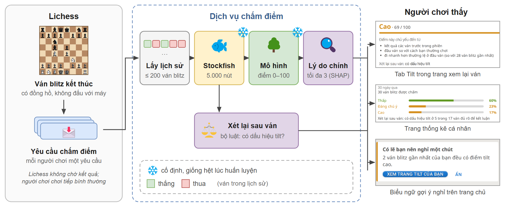

# Vận hành cùng Lichess

## Luồng chấm một ván

Mỗi ván blitz kết thúc đi qua các bước trong hình. Lila chỉ ghi lại yêu cầu chấm
điểm rồi làm tiếp việc bình thường, nên việc chấm không làm chậm ván cờ hay trang
web. Dịch vụ chấm điểm dùng đúng cấu hình Stockfish và cách tính đặc trưng như
lúc huấn luyện. Nó từ chối chạy nếu trọng số mô hình hoặc mã tính đặc trưng không
khớp với bản đã đánh giá.



*Các bước chấm điểm một ván sau khi ván kết thúc. Bông tuyết đánh dấu phần cố
định, giống hệt lúc huấn luyện.*

Cách làm theo cùng mẫu với Kaladin của Lichess
(`lila/modules/irwin/src/main/KaladinApi.scala`): lila ghi yêu cầu vào một
collection MongoDB, dịch vụ Python bên ngoài ghi kết quả ngược lại.

1. **Lila tạo yêu cầu.** Module `lila/modules/tilt` nghe sự kiện kết thúc ván.
   Với ván cờ tiêu chuẩn có đồng hồ, không đấu với máy, có hơn 1 nửa nước, lila
   ghi vào collection `tilt_queue` một yêu cầu cho mỗi người chơi. Chỉ chạy khi
   `tilt.enabled = true` (mặc định `false` trong `conf/base.conf`; bản local bật
   trong `conf/application.conf`).
2. **Worker lấy yêu cầu.** `python -m tilt lila-worker` đọc các yêu cầu chưa có
   `response`, cứ 10 giây một lần. Yêu cầu không phải blitz được trả ngay
   `skip: speed`, không tốn công tải ván hay chạy engine.
3. **Lấy lịch sử.** Worker tải tối đa 200 ván gần nhất của người chơi qua API
   export của lila, lọc blitz ở phía worker (lila local không có lila-search), rồi
   lưu vào thư mục dữ liệu riêng `tilt/data/external/lila-v3`.
4. **Stockfish.** Phân tích các thế cờ còn thiếu với 5.000 nút mỗi thế cờ, giống
   lúc huấn luyện. Kết quả được lưu đệm theo thế cờ.
5. **Mô hình.** Dựng đặc trưng như lúc huấn luyện, chấm bằng đầu `p20` nếu ván có
   từ 20 nửa nước, ngược lại bằng đầu `pre`. Kết quả là điểm 0–100 và mức.
6. **Lý do chính.** Tính đóng góp của từng nhóm đặc trưng bằng SHAP (xem dưới).
7. **Xét lại sau ván.** Áp bộ luật v3 lên ván đã xong để cho kết luận TILT /
   KHÔNG / không gán nhãn. Luật E7 (vào ván mới ngay sau ván thua) cần biết ván
   kế tiếp, nên khi người chơi có ván mới, worker tính lại kết luận của tối đa 5
   ván trước còn chờ luật này.
8. **Ghi kết quả.** Worker ghi `response = {at, pred}` vào đúng yêu cầu. Nếu lỗi
   thì ghi `{at, err}`. Gặp lỗi 5xx từ lila thì giữ yêu cầu lại để thử lần sau.
   Lila chưa chạy thì yêu cầu vẫn nằm trong hàng đợi.

## Lý do của điểm

Lý do được tính bằng SHAP: mỗi đặc trưng làm điểm tăng hay giảm bao nhiêu. Các
đặc trưng được gộp theo nhóm (bảng ở
[Xây dựng mô hình](xay-dung-mo-hinh.md#5-trích-xuất-đặc-trưng)) và đặt tên bằng
lời thường, như "kết quả các ván trước trong buổi chơi" hay "đầu ván so với cách
bạn thường chơi".

- Giao diện hiện tối đa ba nhóm, mỗi nhóm chiếm ít nhất 10% phần làm điểm tăng.
- Nhóm thông tin ván và nhóm trình độ không được dùng làm lý do, dù vẫn tính vào
  điểm.
- Lý do "đi nhanh hơn thường lệ" được kiểm tra chặt hơn: người chơi phải có ít
  nhất 20 ván blitz làm mốc, điểm z ≤ −1,5, và việc đi nhanh vẫn rõ (z ≤ −1) sau
  khi bỏ bốn nước khai cuộc đầu, vốn hay được đi theo trí nhớ.

Chữ trên giao diện (tiếng Việt và tiếng Anh) nằm trong
`lila/modules/tilt/src/main/TiltText.scala`. Một test chặn các từ chuyên môn như
"mô hình", "nửa nước", "v3", "z =", "luật" để người chơi chỉ thấy lời thường.

## Lời gợi ý nghỉ

Lila quyết định có hiện biểu ngữ hay không (`TiltBanner.scala`) dựa trên các ván
đã chấm trong buổi chơi hiện tại:

- hiện khi hai ván gần nhất đều ở mức Cao, hoặc ván gần nhất ở mức Cao và bộ luật
  thấy ngữ cảnh mạnh;
- mỗi buổi chơi tối đa một lần, các lần cách nhau ít nhất 30 phút;
- ván gần nhất phải kết thúc trong 30 phút qua;
- không hiện khi người chơi đang trong ván;
- trạng thái đã hiện, đã ẩn, đã tắt lưu trong collection `tilt_banner`.

Mở trang chủ bằng tài khoản đó, kể cả từ script, là biểu ngữ bị tính "đã hiện".

## Cách chạy

### Cả hệ thống

```bash
tilt/scripts/start-lichess.sh
```

Script bật lila-ws, worker Tilt, fishnet local, rồi lila ở foreground (Ctrl+C
dừng tất cả). Worker chỉ được bật khi có `tilt/data/processed/models/` và salt ở
`~/.tilt-salt`. Log của worker ở `~/.lichess-logs/tilt.log`.

### Chỉ chạy worker

```bash
pip install -e 'tilt[lila]'      # cần pymongo
TILT_SALT="$(cat ~/.tilt-salt)" tilt/.venv/bin/python -m tilt lila-worker
```

| Tham số | Mặc định | Ý nghĩa |
|---|---|---|
| `--data` (đặt trước `lila-worker`) | `tilt/data` | Nơi đọc mô hình |
| `--lila-url` | `http://localhost:9663` | Địa chỉ lila để export ván |
| `--mongo`, `--db` | MongoDB local, `lichess` | Nơi có `tilt_queue` |
| `--lila-data` | `tilt/data/external/lila` | Thư mục dữ liệu của P3-B |
| `--lila-data-v3` | `<lila-data>-v3` | Thư mục dữ liệu của M-v3 (chỉ blitz) |
| `--engine` | `/usr/games/stockfish` | Stockfish |
| `--interval` | 10 | Số giây giữa hai lần đọc hàng đợi |
| `--once` | | Trả lời hàng đợi hiện có rồi thoát |

### Chấm thử một ván

```bash
cd tilt/src
TILT_SALT="$(cat ~/.tilt-salt)" ../.venv/bin/python -m tilt.service.live_scoring score \
  --models ../data --root ../data/external/lila-v3/processed --player <tên> --game <id>
```

Lệnh in ra đúng các trường mà worker sẽ ghi vào `response`.

## Mô hình đang chạy

- Con trỏ `tilt/data/processed/models/deployed_v3.json` trỏ tới bundle
  `v3/M-v3.joblib` và danh sách đặc trưng `v3/feature_registry.csv`, kèm hash
  SHA-256 của cả hai. Worker từ chối nạp nếu hash không khớp.
- Worker còn kiểm tra hash của sáu tệp mã tính đặc trưng, bộ luật và huấn luyện
  (`check_frozen` trong `service/live_scoring.py`). Sửa các tệp đó mà không cập nhật
  hash thì worker dừng với lỗi `Frozen v3 code changed`. Danh sách tệp và cách
  cập nhật ở [Mã nguồn](ma-nguon.md#mã-bị-khóa-bằng-hash).
- Cài một bundle mới (ghi lại `deployed_v3.json`):

  ```bash
  ../.venv/bin/python -m tilt.service.live_scoring install --models ../data \
    --bundle <M-v3.joblib> --registry <feature_registry.csv>
  ```

## Mô hình cũ P3-B

P3-B (`deployed.json`, bundle `phase5/by_player__P3-B.joblib`) vẫn chạy ẩn song
song tới ngày `shadow_until` ghi trong `deployed_v3.json` (1/12/2026): worker
chấm cả hai, lưu điểm P3-B vào trường `shadow` để đối chiếu, nhưng giao diện chỉ
dùng M-v3. Lỗi ở P3-B không bao giờ chặn hay đổi kết quả hiển thị. Dữ liệu của P3-B nằm ở
`tilt/data/external/lila`.

**Quay về P3-B:** xóa `tilt/data/processed/models/deployed_v3.json` rồi khởi
động lại worker. Khi không còn con trỏ v3, worker tự dùng P3-B.

## Giới hạn

- Điểm cao nghĩa là ván khớp với luật v3, không phải đo cảm xúc thật.
- Chỉ chấm blitz. Ván dưới 20 nửa nước chỉ dùng được đầu `pre`, nên kém tin cậy
  hơn.
- Người chơi mới có ít ván thì mức thường lệ còn trống, nhiều đặc trưng bị thiếu.
- Kết quả không có ngay khi ván kết thúc: worker phải tải lịch sử và chạy
  Stockfish cho các thế cờ chưa có trong bộ đệm.
