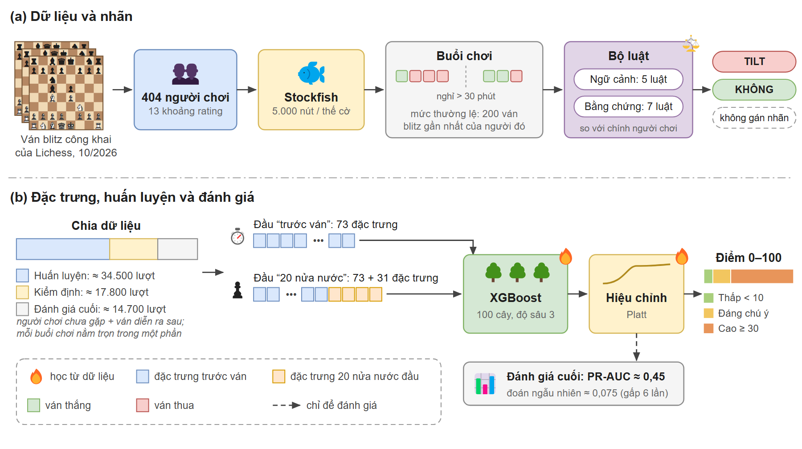
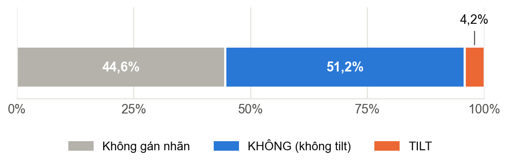

# Xây dựng và huấn luyện mô hình

Module có hai phần. Phần thứ nhất là xây dựng mô hình, làm một lần trên dữ liệu
công khai của Lichess, trình bày ở tài liệu này. Phần thứ hai là dịch vụ chấm
điểm chạy cạnh máy chủ Lichess, trình bày ở [Vận hành](van-hanh.md).



*Quy trình xây dựng mô hình: (a) dữ liệu và nhãn; (b) đặc trưng, huấn luyện và
đánh giá.*

## 1. Thu thập dữ liệu

Nguồn là bản tổng hợp các ván tháng 10/2026 mà Lichess công bố công khai.

- Chọn 404 người chơi blitz, chia đều theo 13 khoảng rating rộng 200 điểm từ
  400 đến 3000. Nhờ vậy dữ liệu có đủ người mới lẫn người chơi mạnh, không dồn
  vào mức rating phổ biến.
- Với mỗi người, tải các ván blitz gần nhất (tối đa 150–300 ván) qua API công
  khai của Lichess, tuân thủ giới hạn tốc độ của trang.
- Kết quả là 67.014 lượt người chơi – ván.

## 2. Phân tích ván bằng Stockfish

Mọi thế cờ được phân tích với cùng một cấu hình cố định:

- 5.000 nút tìm kiếm cho mỗi thế cờ;
- xét hai phương án tốt nhất (MultiPV = 2);
- một luồng, làm mới bộ nhớ engine trước mỗi thế cờ.

Cấu hình theo số nút (thay vì theo thời gian) giúp kết quả không phụ thuộc tốc
độ máy: phân tích lại 500 thế cờ trên ba máy khác nhau cho kết quả trùng
500/500. Kết quả được lưu theo thế cờ và cấu hình, nên chạy lại không phải tính
lại.

Từ đánh giá của Stockfish, mỗi nước đi được tính CPL và phân loại thành không
chính xác, sai lầm hoặc sai lầm nghiêm trọng theo đúng công thức của Lichess.
Thời gian suy nghĩ lấy từ đồng hồ ghi trong ván. Toàn bộ nửa nước đều có đánh
giá, 96,2% nước có thời gian suy nghĩ.

## 3. Buổi chơi và mức thường lệ

Các ván của một người được chia thành buổi chơi: buổi mới bắt đầu khi khoảng
nghỉ giữa hai ván dài hơn 30 phút.

Mỗi người chơi có một mức thường lệ riêng, tính từ tối đa 200 ván blitz gần nhất
đã kết thúc trước ván đang xét. Mỗi chỉ số của ván (độ chính xác, số sai lầm,
thời gian suy nghĩ…) được đổi thành điểm z bền vững:

```text
z = (giá trị − trung vị của người đó) / max(1,4826 × độ lệch tuyệt đối trung vị, ngưỡng tối thiểu)
```

Ví dụ, z = 1 về CPL nghĩa là ván này kém hơn mức thường lệ của chính người đó
khoảng một độ lệch. Cần ít nhất 5 ván để có mức thường lệ. Nếu không đủ, chỉ số
để trống, không lấy trung bình của người khác điền vào. Chi tiết ở
[Dữ liệu Lichess](du-lieu-lichess.md#mức-thường-lệ).

## 4. Gán nhãn bằng bộ luật

Không có bộ dữ liệu nào ghi sẵn ván nào người chơi đang tilt, nên tilt được định
nghĩa bằng một bộ luật rõ ràng. Bộ luật và cách đánh giá được viết ra và khóa
lại trước khi xem bất kỳ kết quả nào, để không thể chỉnh luật theo kết quả.

| Nhóm | Dấu hiệu |
|---|---|
| Ngữ cảnh trong buổi chơi (5 luật, C1–C5) | Thua liên tiếp từ 2 ván; thua 3 trong 5 hoặc 5 trong 10 ván gần nhất; nhiều ván thua dồn vào thời gian gần (ván thua càng gần càng nặng); rating giảm từ 30 điểm so với đầu buổi; vào ván mới trong 2 phút sau ván thua và khoảng nghỉ ngắn dần. Ngữ cảnh **mạnh** khi có từ 2 luật, **yếu** khi có 1 luật hoặc vừa thua ván trước. |
| Cách chơi trong ván (7 luật, E1–E7) | CPL cao hơn thường lệ (z ≥ 1); nhiều sai lầm nghiêm trọng hơn thường lệ (z ≥ 1); đi nhanh hơn thường lệ (z ≤ −1); thời gian suy nghĩ thất thường (z ≥ 1); chơi liều lĩnh hơn (z ≥ 1); xin thua hoặc bỏ ván khi còn từ 20% cơ hội; vào ván mới gần như ngay sau ván thua (tối đa 60 giây). |
| Kết luận | **TILT** khi CPL cao hơn thường lệ và: ngữ cảnh mạnh kèm ít nhất 2 dấu hiệu cách chơi, hoặc ngữ cảnh yếu kèm ít nhất 3. Ván thắng cần điều kiện chặt hơn. **KHÔNG** khi gần như không có dấu hiệu nào. Các trường hợp còn lại không được gán nhãn. |

Vùng "không gán nhãn" là điểm khác biệt quan trọng: ván mơ hồ không bị ép vào
một lớp, và mô hình chỉ học, chỉ bị chấm trên các ván có kết luận rõ. Trên phần
dữ liệu huấn luyện, 55,4% lượt có kết luận, và trong số đó chỉ 7,6% là TILT
(1.443 TILT so với 17.659 KHÔNG). Bộ luật có 74 ca kiểm thử, phủ từng ô của bảng
kết hợp.



*Kết luận của bộ luật trên phần huấn luyện, tính trên tổng số lượt.*

## 5. Trích xuất đặc trưng

Bộ luật chỉ kết luận được khi ván đã xong, có luật (E7) còn cần biết người chơi
có vào ván mới ngay hay không. Để có tín hiệu sớm, mô hình được huấn luyện để
đoán trước kết luận của bộ luật, chỉ dùng những gì đã biết tại thời điểm dự
đoán. Mô hình có hai đầu:

- đầu **trước ván** (`pre`) dùng 73 đặc trưng có sẵn khi ván bắt đầu;
- đầu **20 nửa nước** (`p20`) dùng thêm 31 đặc trưng từ 20 nửa nước đầu, tổng
  104 đặc trưng.

Ván có từ 20 nửa nước được chấm bằng đầu `p20`, ván ngắn hơn bằng đầu `pre`.

| Thời điểm | Nhóm | Số cột | Nội dung |
|---|---|---:|---|
| Trước ván | Thông tin ván | 5 | Thời gian ban đầu, thời gian cộng thêm, rating, chênh rating với đối thủ, màu quân |
| Trước ván | Ngữ cảnh buổi chơi | 20 | Chuỗi thua, số ván thua gần đây, thay đổi rating trong buổi, số ván và độ dài buổi, các khoảng nghỉ, trạng thái 5 luật ngữ cảnh |
| Trước ván | Lịch sử | 4 | Chuỗi tái đấu, chuỗi thua, thời gian nghỉ trước ván, phong độ gần đây |
| Trước ván | Ván ngay trước | 21 | Các chỉ số và điểm z của ván trước trong buổi, trạng thái các luật và kết luận của ván đó, độ dài và cách kết thúc |
| Trước ván | Cách chơi trong buổi | 7 | Trung bình điểm z của 3 ván gần nhất, số ván TILT và số dấu hiệu trung bình của 10 ván gần nhất |
| Trước ván | Mức thường lệ | 16 | Trung vị và độ phân tán của 7 chỉ số cách chơi, số ván làm mốc |
| 20 nửa nước đầu | Chất lượng | 6 | CPL, CPL lớn nhất, số nước không chính xác, sai lầm, sai lầm nghiêm trọng, CPL của đối thủ |
| 20 nửa nước đầu | Thời gian | 5 | Trung vị và độ biến thiên thời gian suy nghĩ, lần nghĩ lâu nhất, phần đồng hồ đã dùng, thời gian nước đầu |
| 20 nửa nước đầu | Phong cách | 8 | Tỉ lệ nước mạo hiểm, tấn công, phòng thủ, đổi quân, thí quân và ba chỉ số về nhịp độ |
| 20 nửa nước đầu | Thế cờ | 5 | Cơ hội thắng sau nửa nước 20 và thấp nhất trong đoạn, cân bằng lực lượng, số nước hợp lệ, giai đoạn ván |
| 20 nửa nước đầu | So với thường lệ | 7 | Điểm z của CPL, thời gian và phong cách so với 20 nửa nước đầu của các ván trước |

Kết luận của các ván trước được dùng làm đặc trưng hợp lệ, vì chúng có trước khi
ván đang xét bắt đầu. Ván ngắn hơn 20 nửa nước không được gán giá trị giả hay một
cột "ván ngắn", để mô hình không học mẹo đoán theo độ dài ván.

## 6. Chống rò rỉ thông tin

Rủi ro lớn nhất là mô hình vô tình dùng thông tin chỉ có sau thời điểm dự đoán,
như kết quả ván, rồi cho số đo đẹp nhưng vô dụng khi chạy thật. Chín nhóm kiểm
thử tự động kiểm tra điều này, trong đó có:

- danh sách đặc trưng không chứa kết quả, cách kết thúc, độ dài ván hay chỉ số
  nào tính trên cả ván;
- đổi các nước sau nửa nước 20, kết quả, giờ kết thúc, hoặc xóa các ván diễn ra
  sau, thì mọi đặc trưng vẫn giữ nguyên tuyệt đối;
- đặc trưng tính từ dữ liệu đầy đủ bằng đặc trưng tính từ dữ liệu bị cắt đúng
  tại thời điểm dự đoán;
- xóa toàn bộ nước đi của ván không làm đổi đặc trưng "trước ván";
- chạy lại hai lần cho kết quả giống hệt, và nhãn tính lại khớp 100% với bản gốc.

Ngoài ra, khả năng phân biệt ván ngắn của từng đặc trưng được đo riêng, để phát
hiện sớm khi mô hình dựa vào độ dài ván. Đây là bài học từ các vòng trước: đặc
trưng hay điểm nào cũng phải kiểm tra rò rỉ độ dài ván.

## 7. Chia dữ liệu

| Phần | Số lượt | Dùng để |
|---|---:|---|
| Huấn luyện | khoảng 34.500 | mô hình học |
| Kiểm định | khoảng 17.800 | hiệu chỉnh và kiểm tra trong lúc xây dựng |
| Đánh giá cuối | khoảng 14.700 | người chơi mô hình chưa từng thấy (A′) và các ván diễn ra sau cùng (B′) |

Phần đánh giá cuối được giữ kín đến bước cuối và chỉ chấm đúng một lần, để kết
quả phản ánh đúng khi gặp người chơi mới và ván mới. Mỗi buổi chơi nằm trọn trong
một phần, không bị cắt ngang. Hai phần A′/B′ nay đã mở, không còn dùng làm dữ
liệu chưa chạm được nữa.

## 8. Huấn luyện

Mô hình là XGBoost: nhiều cây quyết định nhỏ học nối tiếp nhau, hợp với dữ liệu
dạng bảng có giá trị thiếu.

- **Cấu hình cố định chọn trước:** 100 cây, độ sâu tối đa 3, tốc độ học 0,06,
  mỗi cây dùng 85% số dòng và 85% số đặc trưng, hệ số điều chuẩn 3. Không dò
  tham số, không dừng sớm, không chọn đặc trưng theo kết quả kiểm định.
- **Giá trị thiếu** được điền bằng trung vị kèm một cột cho biết có bị thiếu hay
  không, vì việc thiếu cũng mang nghĩa (ví dụ chưa có ván trước trong buổi). Các
  thông số điền và chuẩn hóa chỉ tính trên tập huấn luyện.
- **Mất cân bằng lớp:** TILT chỉ khoảng 7,6%, nên mỗi mẫu được đánh trọng số để
  hai lớp có ảnh hưởng ngang nhau.
- **Hiệu chỉnh xác suất:** đầu ra được hiệu chỉnh bằng phương pháp Platt trên
  phần kiểm định để điểm có thể đọc như xác suất. Khi đo trên phần kiểm định,
  phần hiệu chỉnh của mỗi người chơi được học từ nửa người chơi còn lại, nên số
  đo không bị lạc quan.
- **Tái lập:** toàn bộ huấn luyện và đánh giá chạy hai lần độc lập cho kết quả
  giống hệt.

PR-AUC trên phần huấn luyện và kiểm định khá gần nhau (đầu `p20`: 0,545 và
0,487; đầu `pre`: 0,405 và 0,299), cho thấy mô hình không học thuộc dữ liệu
huấn luyện nhiều.

## 9. Cách đánh giá

- **Chỉ số chính là PR-AUC**, hợp với lớp hiếm: đoán ngẫu nhiên đạt đúng bằng tỉ
  lệ TILT (khoảng 0,075).
- Báo thêm ROC-AUC và sai số hiệu chỉnh (ECE: độ lệch giữa xác suất dự đoán và
  tần suất thật).
- Khoảng tin cậy 95% tính bằng bootstrap 1.000 lần, lấy mẫu lại theo người chơi.
- Kết quả báo riêng cho ván từ 40 nửa nước trở lên và ván ngắn hơn.
- Mô hình được so với năm cách ước tính đơn giản hơn: chỉ dùng ngữ cảnh buổi chơi
  của bộ luật, số ván thua liên tiếp, trình độ người chơi, cách chơi trong cả
  ván, và kết quả ván.
- Quy tắc chấp nhận được viết và khóa trước khi có bất kỳ con số nào trên phần
  đánh giá cuối.

Trên phần kiểm định, mô hình đạt PR-AUC 0,486 (khoảng tin cậy 0,448–0,526),
trong khi cách so sánh tốt nhất đạt 0,282. Kết quả trên phần đánh giá cuối ở
[Kết quả](ket-qua.md).

## Các mô hình trước M-v3

M-v3 là vòng thứ ba. Hai vòng trước để lại bài học cho thiết kế hiện tại:

- **P3-B** (Phase 0–5) học từ nhãn yếu: một tập luật hành vi tính trên cả ván.
  Mô hình này vẫn chạy ẩn song song tới 1/12/2026 để đối chiếu, xem
  [Vận hành](van-hanh.md#mô-hình-cũ-p3-b).
- **Nhãn v2** không qua được cổng kiểm tra đã khóa trước nên bị bỏ.

Báo cáo đầy đủ các vòng ở [`tilt_final_report.md`](../reports/tilt_final_report.md)
và [`final_model_comparison.md`](../reports/final_model_comparison.md).
